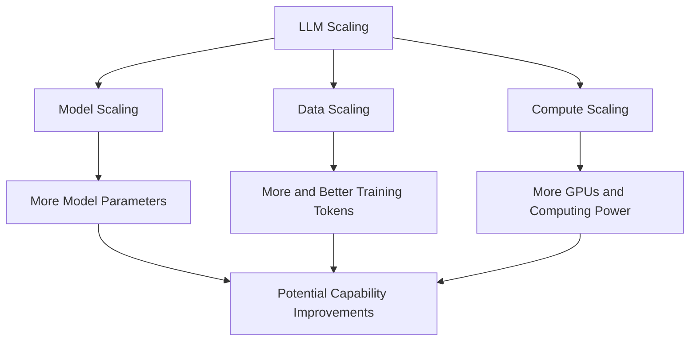
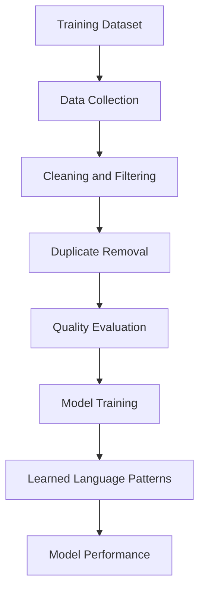
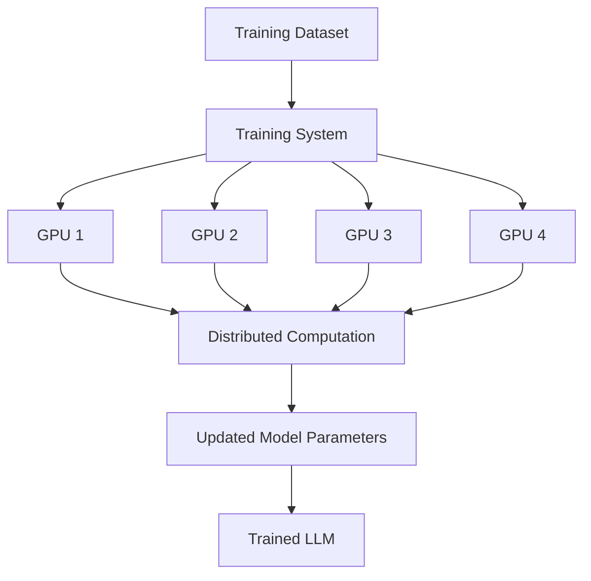
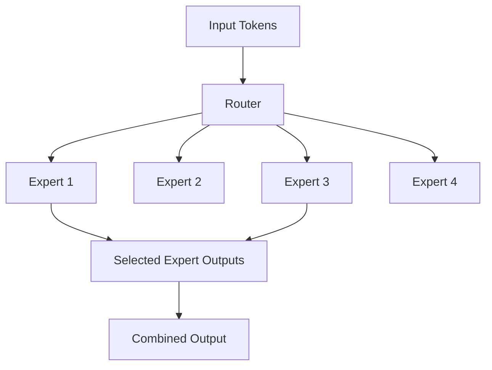
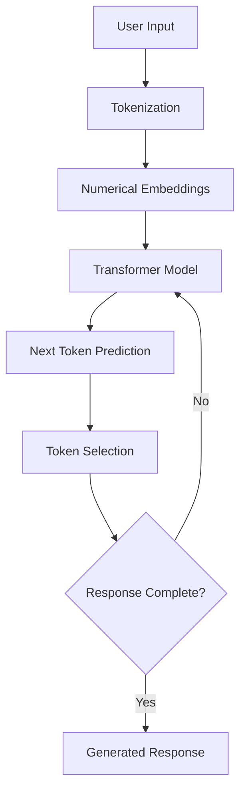
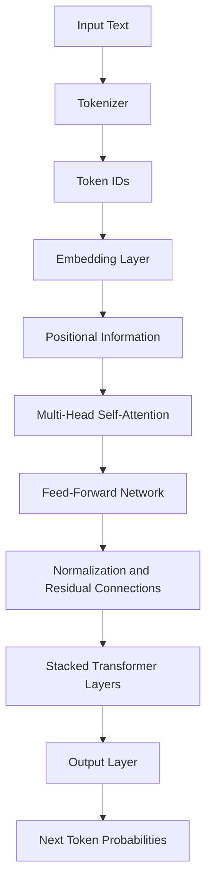
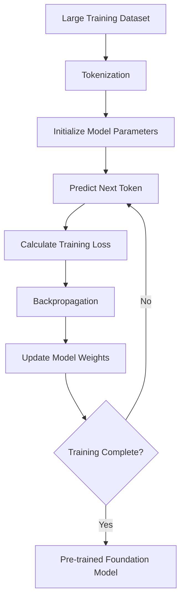
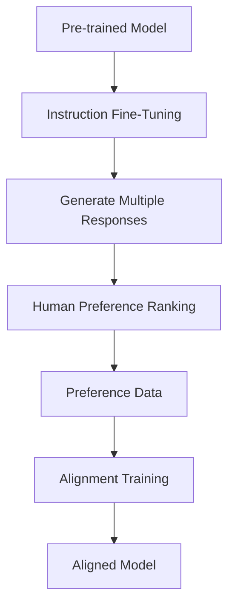
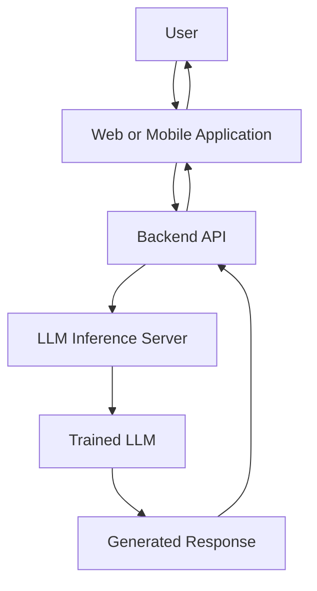
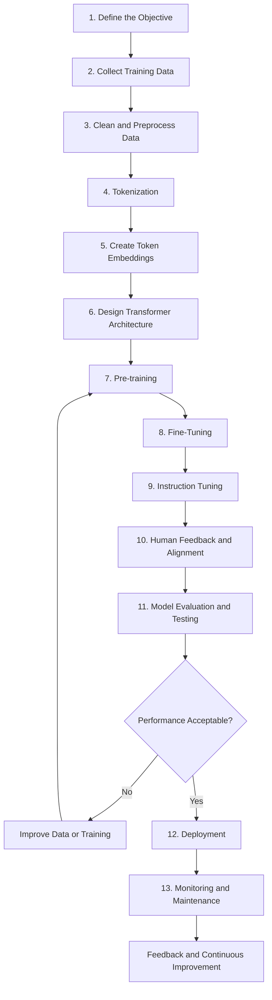

# Aim:	Comprehensive Report on the Fundamentals of Generative AI and Large Language Models (LLMs)
Experiment:
Develop a comprehensive report for the following exercises:
1.	Explain the foundational concepts of Generative AI. 
2.	Focusing on Generative AI architectures. (like transformers).
3.	Generative AI applications.
4.	Generative AI impact of scaling in LLMs.

# Algorithm: Step 1: Define Scope and Objectives
1.1 Identify the goal of the report (e.g., educational, research, tech overview)
1.2 Set the target audience level (e.g., students, professionals)
1.3 Draft a list of core topics to cover
Step 2: Create Report Skeleton/Structure
2.1 Title Page
2.2 Abstract or Executive Summary
2.3 Table of Contents
2.4 Introduction
2.5 Main Body Sections:
•	Introduction to AI and Machine Learning
•	What is Generative AI?
•	Types of Generative AI Models (e.g., GANs, VAEs, Diffusion Models)
•	Introduction to Large Language Models (LLMs)
•	Architecture of LLMs (e.g., Transformer, GPT, BERT)
•	Training Process and Data Requirements
•	Use Cases and Applications (Chatbots, Content Generation, etc.)
•	Limitations and Ethical Considerations
•	Future Trends
2.6 Conclusion
2.7 References
________________________________________
Step 3: Research and Data Collection
3.1 Gather recent academic papers, blog posts, and official docs (e.g., OpenAI, Google AI)
3.2 Extract definitions, explanations, diagrams, and examples
3.3 Cite all sources properly
________________________________________
Step 4: Content Development
4.1 Write each section in clear, simple language
4.2 Include diagrams, figures, and charts where needed
4.3 Highlight important terms and definitions
4.4 Use examples and real-world analogies for better understanding
________________________________________
Step 5: Visual and Technical Enhancement
5.1 Add tables, comparison charts (e.g., GPT-3 vs GPT-4)
5.2 Use tools like Canva, PowerPoint, or LaTeX for formatting
5.3 Add code snippets or pseudocode for LLM working (optional)
________________________________________
Step 6: Review and Edit
6.1 Proofread for grammar, spelling, and clarity
6.2 Ensure logical flow and consistency
6.3 Validate technical accuracy
6.4 Peer-review or use tools like Grammarly or ChatGPT for suggestions
________________________________________
Step 7: Finalize and Export
7.1 Format the report professionally
7.2 Export as PDF or desired format
7.3 Prepare a brief presentation if required (optional)


# Output

## ChatGPT 

## Prompt 1:

Act as an expert Artificial Intelligence professor. Prepare a comprehensive report explaining the foundational concepts of Generative AI for undergraduate engineering students.

Include the following topics:
1. Introduction and definition of Generative AI.
2. Difference between Artificial Intelligence, Machine Learning, Deep Learning and Generative AI.
3. How Generative AI works.
4. Different types of Generative AI models.
5. Role of neural networks and training data.
6. Examples of popular Generative AI tools.
7. Advantages, limitations and challenges.
8. Ethical issues such as bias, privacy and misinformation.
9. Real-world applications.

Use simple technical language, practical examples, comparison tables and appropriate headings. Conclude with the importance of Generative AI in modern technology.

# EXPERIMENT 1: FUNDAMENTALS OF GENERATIVE AI

## AIM

To study the foundational concepts of Generative Artificial Intelligence, understand its architectures, applications, advantages, limitations and ethical considerations.

## 1. INTRODUCTION TO GENERATIVE AI

### 1.1 Definition of Generative AI

Generative Artificial Intelligence (Generative AI) is a branch of Artificial Intelligence (AI) that focuses on creating new content such as text, images, audio, videos, music and computer code by learning patterns from existing data.

Unlike traditional AI systems that mainly analyze data, classify information or make predictions, Generative AI can produce new outputs based on user instructions called prompts.

**Examples:**
- ChatGPT generates text and answers questions.
- Google Gemini generates text, images and other content.
- DALL-E generates images from text descriptions.
- GitHub Copilot assists in writing computer programs.

### 1.2 Introduction

Generative AI uses advanced machine learning techniques, particularly Deep Learning and Neural Networks, to understand patterns in large datasets and generate new content.

It has become an important technology in education, healthcare, banking, software development, entertainment and scientific research.

**Example:**

When a user enters the prompt:

"Write a Python program to calculate the factorial of a number."

A Generative AI tool understands the instruction and generates the required Python code.

## 2. DIFFERENCE BETWEEN TRADITIONAL AI AND GENERATIVE AI

Traditional AI and Generative AI are two important areas of Artificial Intelligence. They differ mainly in their purpose and output.

| Traditional AI | Generative AI |
|---|---|
| Analyzes existing data. | Generates new content. |
| Mainly performs classification and prediction. | Creates text, images, audio and code. |
| Identifies patterns and makes decisions. | Learns patterns and produces new outputs. |
| Usually works on predefined tasks. | Can handle a wide range of creative tasks. |
| Example: Email spam detection. | Example: Generating an email using ChatGPT. |
| Example: Weather prediction. | Example: Generating a weather report in natural language. |

**Example:**
- Traditional AI identifies whether an email is spam or not.
- Generative AI can write a new email based on the user's instructions.

## 3. WORKING PRINCIPLES OF GENERATIVE AI

Generative AI works by learning patterns and relationships from large amounts of training data. It uses trained models to generate new content based on the input provided by users.

### 3.1 Steps Involved in Generative AI

1. **Data Collection:** Collect text, images, audio and other datasets.
2. **Data Preprocessing:** Clean and organize the collected data.
3. **Model Training:** Train neural networks to learn patterns from the data.
4. **Prompt Input:** User provides instructions or questions.
5. **Content Generation:** The trained model generates a suitable output.
6. **Final Output:** Text, images, audio, video or code.

### 3.2 Example

Suppose a student enters the prompt:

"Explain Machine Learning in simple words."

The Generative AI model:

1. Processes the user's input.
2. Identifies the meaning of the prompt.
3. Uses patterns learned during training.
4. Predicts suitable words and sentences.
5. Generates an understandable explanation.

## 4. TYPES OF GENERATIVE AI MODELS

There are several architectures and techniques used in Generative AI. The four important types are GANs, VAEs, Diffusion Models and Transformers.

### 4.1 Generative Adversarial Networks (GANs)

A Generative Adversarial Network (GAN) consists of two competing neural networks:

**1. Generator**
- Creates artificial or synthetic data.
- Tries to generate content that looks realistic.

**2. Discriminator**
- Examines the generated content.
- Tries to distinguish real data from fake data.

Both networks compete with each other during training, improving the quality of generated content.

**Applications:**
- Realistic image generation.
- Image enhancement.
- Animation and visual effects.
- Synthetic data generation.

### 4.2 Variational Autoencoders (VAEs)

A Variational Autoencoder (VAE) is a generative model that learns a compressed representation of input data and uses it to generate new similar data.

It consists of two main components:

- **Encoder:** Compresses input data into a smaller representation called latent space.
- **Decoder:** Reconstructs the data or generates new samples from the latent representation.

**Applications:**
- Image generation.
- Data compression.
- Image reconstruction.
- Anomaly detection.

### 4.3 Diffusion Models

Diffusion Models are Generative AI models that create new data by learning to reverse a process of gradually adding noise to training examples.

They are widely used in image generation.

**Working Process:**

1. Training involves gradually adding noise to images.
2. The model learns how to remove that noise.
3. During generation, it starts with random noise.
4. It repeatedly removes noise to produce a meaningful image.

**Applications:**
- AI image generation.
- Digital artwork.
- Image editing.
- Product design.

### 4.4 Transformers

Transformers are deep learning architectures designed to process sequential information and learn relationships between different parts of input data.

They use a mechanism called **Self-Attention**, which helps the model understand the relationship between words in a sentence.

**Important Components:**

1. **Input Embedding:** Converts input tokens into numerical representations.
2. **Positional Encoding:** Provides information about token positions.
3. **Self-Attention:** Identifies relationships between tokens.
4. **Feed-Forward Network:** Processes the learned representations.
5. **Output Layer:** Produces the required prediction or output.

**Applications:**
- Chatbots.
- Language translation.
- Text summarization.
- Code generation.
- Question answering.

Examples include GPT, BERT and T5. GPT is primarily a decoder-only Transformer, while the original BERT architecture uses an encoder-only Transformer.

## 5. ROLE OF TRAINING DATA AND NEURAL NETWORKS

### 5.1 Training Data

Training data is the information used to teach a Generative AI model how to recognize patterns and relationships.

It may include:
- Text documents and books.
- Images and photographs.
- Audio recordings.
- Videos.
- Programming code.

**Importance of Training Data:**

1. Helps models learn language and patterns.
2. Improves the quality of generated outputs.
3. Provides knowledge for different tasks.
4. Influences the accuracy and reliability of results.

High-quality, diverse and relevant training data is essential for developing reliable Generative AI systems.

### 5.2 Neural Networks

Neural Networks are computational models inspired by the way biological brains process information.

They consist of interconnected artificial neurons arranged in layers.

**The Main Layers Are:**

- **Input Layer:** Receives the input data.
- **Hidden Layers:** Learn complex patterns and relationships.
- **Output Layer:** Produces the final result.

Neural networks are important because they allow Generative AI models to learn complex patterns and generate meaningful content.

## 6. ADVANTAGES AND LIMITATIONS OF GENERATIVE AI

### 6.1 Advantages

1. **Content Creation:** Generates text, images, music and videos.
2. **Time Saving:** Automates repetitive tasks and reduces manual effort.
3. **Education:** Helps students understand difficult subjects.
4. **Software Development:** Assists programmers in writing and debugging code.
5. **Creativity:** Supports brainstorming and creative activities.
6. **Productivity:** Improves efficiency in different industries.

### 6.2 Limitations

1. **Hallucination:** May generate incorrect or misleading information.
2. **Data Dependency:** Performance depends on training data quality.
3. **Bias:** May reproduce biases present in training data.
4. **High Computational Cost:** Training advanced models requires significant computing resources.
5. **Privacy Risks:** Sensitive information may be exposed or mishandled.
6. **Lack of Human Understanding:** Generated responses do not necessarily represent genuine human understanding.

## 7. ETHICAL CONCERNS IN GENERATIVE AI

Generative AI introduces several ethical challenges that must be considered during its development and use.

### 7.1 Bias

AI models may produce unfair or discriminatory outputs because of biased training data.

**Example:** An AI recruitment system may unfairly favor certain groups if its training data contains historical hiring bias.

### 7.2 Privacy

Generative AI systems may process personal or confidential information. Improper handling of such information can create privacy risks.

**Example:** Entering confidential company information into an unapproved AI tool may expose sensitive data.

### 7.3 Misinformation

AI can generate false information, fake images, manipulated videos and misleading content.

**Example:** AI-generated fake news or deepfake videos can mislead people.

### 7.4 Copyright and Ownership

AI-generated content may raise questions about ownership, originality and the use of copyrighted training material.

### 7.5 Responsible AI Usage

- Verify important AI-generated information.
- Avoid sharing confidential personal data.
- Check for bias and unfair outputs.
- Respect intellectual property rights.
- Maintain human supervision in important decisions.

## 8. REAL-WORLD APPLICATIONS OF GENERATIVE AI

Generative AI is transforming several industries by automating tasks and creating new possibilities.

### 8.1 Education

- Personalized learning.
- Automatic quiz generation.
- AI tutoring and explanations.
- Assignment assistance.

### 8.2 Healthcare

- Medical research support.
- Medical image analysis.
- Drug discovery research.
- Clinical documentation assistance.

### 8.3 Banking and Finance

- Financial report generation.
- Customer support chatbots.
- Document processing.
- Financial data analysis.

### 8.4 Software Development

- Code generation.
- Debugging assistance.
- Documentation creation.
- Software testing support.

### 8.5 Cybersecurity

- Security report generation.
- Log analysis assistance.
- Security awareness training.
- Threat investigation support.

### 8.6 Entertainment and Media

- Image and video generation.
- Music composition.
- Animation.
- Creative content production.

## 9. COMPARISON OF GENERATIVE AI MODELS

| Model | Main Working Principle | Major Application |
|---|---|---|
| GAN | Generator and discriminator compete | Image generation |
| VAE | Encoder and decoder learn latent representations | Image reconstruction |
| Diffusion | Learns to reverse noise addition | Image generation |
| Transformer | Uses attention mechanisms | Text and code generation |

## 10. FUTURE SCOPE OF GENERATIVE AI

Generative AI is expected to play an important role in future technological development.

Some emerging areas include:

1. **Multimodal AI:** Models that understand and generate text, images, audio and video together.
2. **AI-Powered Education:** Personalized educational assistants for students.
3. **Healthcare Innovation:** Support for medical research and drug discovery.
4. **Autonomous AI Agents:** Systems that can perform multiple tasks with appropriate human oversight.
5. **Advanced Robotics:** Integration of AI models with intelligent robotic systems.
6. **Software Engineering:** More advanced tools for coding, testing and software development.

## 11. CONCLUSION

Generative AI is an important development in Artificial Intelligence that enables machines to create new content such as text, images, audio, videos and computer programs.

This report explains the fundamental concepts of Generative AI, its working principles, major architectures, training data, neural networks, advantages, limitations and ethical challenges.

Architectures such as GANs, VAEs, Diffusion Models and Transformers play important roles in developing modern Generative AI applications. These technologies are transforming industries such as education, healthcare, banking, cybersecurity and software development.

Although Generative AI offers many benefits, responsible usage, data privacy, fairness and human supervision are essential to ensure its safe and effective implementation.

Therefore, Generative AI is an important technology for innovation, automation and future technological advancement.

## 12. REFERENCES

1. Goodfellow, I. et al. (2014). *Generative Adversarial Nets*. Advances in Neural Information Processing Systems.
2. Kingma, D. P. and Welling, M. (2013). *Auto-Encoding Variational Bayes*.
3. Vaswani, A. et al. (2017). *Attention Is All You Need*.
4. Ho, J., Jain, A. and Abbeel, P. (2020). *Denoising Diffusion Probabilistic Models*.
5. [OpenAI – Artificial Intelligence Research](https://openai.com/)
6. [Google DeepMind – AI Research](https://deepmind.google/)
7. [NIST – Artificial Intelligence Resources](https://www.nist.gov/artificial-intelligence)


## RESULT

The foundational concepts of Generative AI were studied, including its architectures, working principles, applications, advantages, limitations and ethical concerns. The experiment provided an understanding of how Generative AI contributes to modern technological development.

## Prompt 2

## Act as an experienced Machine Learning researcher. Develop a detailed technical report focusing on Generative AI architectures, particularly the Transformer architecture.

Explain the following:
1. Introduction to Generative AI architectures.
2. Generative Adversarial Networks (GANs).
3. Variational Autoencoders (VAEs).
4. Diffusion Models.
5. Transformer architecture and its working.
6. Encoder and decoder components.
7. Self-attention mechanism.
8. Multi-head attention mechanism.
9. Positional encoding and tokenization.
10. Applications and limitations of each architecture.

Include simple architectural diagrams, flowcharts, examples and comparison tables. Explain the concepts step by step in a manner suitable for engineering students.

# EXPERIMENT 1: TECHNICAL REPORT ON GENERATIVE AI ARCHITECTURES

## AIM

To study and understand the major architectures used in Generative Artificial Intelligence, including Generative Adversarial Networks (GANs), Variational Autoencoders (VAEs), Diffusion Models, and Transformers, with special emphasis on the Transformer architecture, its components, working principles, applications, and limitations.

---

## 1. INTRODUCTION TO GENERATIVE AI ARCHITECTURES

### 1.1 What is Generative AI?

Generative Artificial Intelligence (Generative AI) is a branch of artificial intelligence that uses machine learning and deep learning models to generate new content based on patterns learned from existing training data.

Unlike traditional AI systems that mainly classify, predict, or recognize information, Generative AI can create new outputs such as:

- Text and documents
- Images and artwork
- Music and audio
- Videos and animations
- Computer programs
- Synthetic datasets

**Examples:**
- ChatGPT – Generates human-like text.
- Google Gemini – Generates text and works with multiple types of input.
- DALL-E – Generates images from text descriptions.
- GitHub Copilot – Generates programming code.

### 1.2 What are Generative AI Architectures?

Generative AI architectures are deep learning model structures designed to learn the underlying patterns and distributions of training data and use them to generate new data.

The major Generative AI architectures are:

1. Generative Adversarial Networks (GANs)
2. Variational Autoencoders (VAEs)
3. Diffusion Models
4. Transformer Models

### 1.3 General Working of Generative AI

```text
       Training Dataset
              |
              v
       Data Preprocessing
              |
              v
       Feature Learning
              |
              v
      Generative AI Model
              |
              v
       Learning Data Patterns
              |
              v
       User Prompt / Input
              |
              v
       Generated Output
```

**Example:**

Input prompt: "Generate an image of a futuristic city."

The model processes the text prompt and generates a new image based on the patterns learned during training.

---

## 2. GENERATIVE ADVERSARIAL NETWORKS (GANs)

### 2.1 Introduction

A Generative Adversarial Network (GAN) is a deep learning architecture introduced by Ian Goodfellow and his research team in 2014.

GANs consist of two neural networks called the **Generator** and the **Discriminator**. These networks compete with each other during training to improve the quality of generated data.

### 2.2 Architecture of GAN

**Main components:**

1. Generator
2. Discriminator

**Generator:**

- Takes random noise as input.
- Learns patterns from the training dataset.
- Produces synthetic data such as images.

**Discriminator:**

- Receives real data from the training dataset and generated data from the generator.
- Determines whether the input is real or artificially generated.
- Provides feedback to improve the generator.

### 2.3 GAN Architecture Diagram

```text
       Random Noise
             |
             v
       +-------------+
       |  Generator  |
       +-------------+
             |
             v
       Generated Data
             |
             v
       +----------------+
       |  Discriminator | <----- Real Training Data
       +----------------+
             |
             v
       Real or Fake?
             |
             v
       Feedback to Both Networks
             |
             v
       Improved Generator
```

### 2.4 Working of GAN Step by Step

**Step 1: Generate random noise**

The generator receives a random vector as input.

**Step 2: Generate synthetic data**

The generator converts random noise into artificial data, such as an image.

**Step 3: Discriminator evaluation**

The discriminator receives both real and generated samples and predicts whether they are real or fake.

**Step 4: Feedback**

The discriminator's prediction provides a learning signal to improve the generator.

**Step 5: Training continues**

Both networks improve through repeated training until the generator produces realistic samples.

### 2.5 Example

Consider a GAN trained using thousands of handwritten digit images.

- The generator creates artificial handwritten digits.
- The discriminator checks whether the generated digits resemble real handwritten digits.
- The generator improves based on the discriminator's feedback.

After training, the GAN can generate new handwritten digit images.

### 2.6 Applications of GANs

- Image generation
- Image enhancement and restoration
- Face and character generation
- Image-to-image translation
- Data augmentation
- Synthetic training data generation

### 2.7 Limitations of GANs

- Training can be unstable.
- Mode collapse may occur, where the generator produces limited varieties of outputs.
- The generator and discriminator must be carefully balanced.
- Training requires significant computational resources.
- Generated outputs may contain unrealistic features.

---

## 3. VARIATIONAL AUTOENCODERS (VAEs)

### 3.1 Introduction

A Variational Autoencoder (VAE) is a generative deep learning architecture that learns a compressed probabilistic representation of input data and uses that representation to generate new samples.

VAEs are based on encoder-decoder neural networks.

They are widely used for image generation, data reconstruction, and representation learning.

### 3.2 Main Components of VAE

A VAE contains three important components:

**1. Encoder**

- Takes the original input data.
- Compresses the input into a lower-dimensional representation.
- Learns the parameters of a probability distribution, commonly mean and variance.

**2. Latent Space**

- Represents the compressed information.
- Stores important features of the input.
- Allows the model to sample new representations.

**3. Decoder**

- Takes a sampled latent representation.
- Reconstructs the original data or generates a new sample.

### 3.3 VAE Architecture Diagram

```text
        Original Input
              |
              v
        +-------------+
        |   Encoder   |
        +-------------+
              |
              v
       Mean and Variance
              |
              v
        Latent Space
              |
              v
       Sample Latent Vector
              |
              v
        +-------------+
        |   Decoder   |
        +-------------+
              |
              v
       Reconstructed Output
```

### 3.4 Working of VAE Step by Step

**Step 1: Input data**

The model receives an input, such as an image of a handwritten digit.

**Step 2: Encoding**

The encoder converts the input into a probability distribution represented by a mean and variance.

**Step 3: Latent sampling**

A latent vector is sampled from the learned distribution. The reparameterization trick allows this sampling process to be used during gradient-based training.

**Step 4: Decoding**

The decoder converts the sampled latent vector into a reconstructed image.

**Step 5: Training**

The model is trained using two objectives:

- Reconstruction loss: Measures how closely the output matches the original input.
- KL divergence: Encourages the learned latent distribution to remain close to a chosen prior distribution, often a standard normal distribution.

### 3.5 VAE Objective Function

The VAE commonly maximizes the Evidence Lower Bound (ELBO):

```text
ELBO = Reconstruction Term - KL Divergence
```

The reconstruction term encourages accurate output, while the KL divergence term regularizes the latent space.

### 3.6 Example

Consider a VAE trained on handwritten digit images.

- The encoder converts an image of digit 5 into a latent representation.
- The model samples a latent vector.
- The decoder uses that vector to reconstruct a digit.
- By sampling different points in the latent space, the model can generate new digit images.

### 3.7 Applications of VAEs

- Image generation
- Image reconstruction
- Anomaly detection
- Data compression and representation learning
- Synthetic data generation
- Drug discovery research

### 3.8 Limitations of VAEs

- Generated images may appear blurry.
- Output quality can be lower than that of some GANs or diffusion models.
- Designing an effective latent space can be challenging.
- The balance between reconstruction quality and latent regularization can affect performance.

---

## 4. DIFFUSION MODELS

### 4.1 Introduction

Diffusion Models are generative deep learning models that create new data by learning to reverse a gradual noise-adding process.

They are especially successful in image generation and are used in modern text-to-image systems.

The basic idea is to gradually add noise to training data and then train a neural network to remove that noise.

### 4.2 Main Components

**1. Forward Diffusion Process**

- Starts with original training data.
- Gradually adds random noise over multiple steps.
- Eventually transforms the data into nearly pure noise.

**2. Reverse Diffusion Process**

- Starts with noisy data.
- Uses a trained neural network to estimate and remove noise.
- Gradually reconstructs a meaningful sample.

### 4.3 Diffusion Model Architecture Diagram

```text
        Original Image
              |
              v
     Forward Diffusion Process
              |
              v
       Add Noise Gradually
              |
              v
        Random Noise
              |
              v
     Reverse Diffusion Process
              |
              v
       Remove Predicted Noise
              |
              v
       Generated Image
```

### 4.4 Working of Diffusion Models Step by Step

**Step 1: Original data**

The model receives an image from the training dataset.

**Step 2: Add noise**

Random noise is gradually added to the image over multiple time steps.

**Step 3: Train the neural network**

The model learns to predict the noise added at different steps.

**Step 4: Start with random noise**

During generation, the model starts with a random noise sample.

**Step 5: Remove noise gradually**

The trained model repeatedly predicts and removes noise.

**Step 6: Generate output**

After multiple denoising steps, a meaningful image is produced.

### 4.5 Example

Input prompt: "A red sports car on a mountain road."

A text-conditioned diffusion model uses the prompt as guidance while generating an image. It starts from noise and progressively creates an image that represents the description.

### 4.6 Applications of Diffusion Models

- Text-to-image generation
- Image editing and restoration
- Image inpainting
- Video generation research
- Audio generation
- Scientific image synthesis

### 4.7 Limitations of Diffusion Models

- Generation can require many processing steps.
- High-quality generation may require significant computing power.
- Training and inference can be computationally expensive.
- Generated images may not always follow every detail in the prompt.
- Models can reproduce biases present in their training data.

---

## 5. TRANSFORMER ARCHITECTURE AND ITS WORKING

### 5.1 Introduction

The Transformer is a deep learning architecture introduced by researchers in the 2017 research paper **"Attention Is All You Need"** by Vaswani and colleagues.

It was originally developed for sequence-to-sequence tasks such as machine translation.

Unlike traditional recurrent neural networks (RNNs), Transformers use attention mechanisms to process relationships between tokens without requiring sequential recurrent processing.

Transformers are the foundation of many modern Large Language Models (LLMs).

**Examples:**

- GPT models
- BERT
- T5
- Transformer-based machine translation systems

### 5.2 Main Components of Transformer

The major components are:

1. Input embedding
2. Positional encoding
3. Encoder
4. Decoder
5. Self-attention
6. Multi-head attention
7. Feed-forward neural network
8. Residual connections and layer normalization

### 5.3 Transformer Architecture Diagram

```text
             Input Text
                 |
                 v
             Tokenization
                 |
                 v
          Input Embeddings
                 |
                 v
          Positional Encoding
                 |
                 v
        +---------------------+
        |      ENCODER        |
        |                     |
        |  Multi-Head         |
        |  Self-Attention     |
        |         |           |
        |  Feed-Forward       |
        |  Network             |
        +---------------------+
                 |
                 v
          Encoded Information
                 |
                 v
        +---------------------+
        |      DECODER        |
        |                     |
        |  Masked Self-       |
        |  Attention          |
        |         |           |
        |  Cross-Attention    |
        |         |           |
        |  Feed-Forward       |
        |  Network             |
        +---------------------+
                 |
                 v
           Linear Layer
                 |
                 v
           Softmax Layer
                 |
                 v
           Output Tokens
```

*Note: This diagram represents the original encoder-decoder Transformer. Decoder-only models such as GPT and encoder-only models such as BERT use different configurations.*

### 5.4 Working of Transformer Step by Step

**Step 1: Input tokenization**

The input sentence is divided into smaller units called tokens.

Example:

```text
Input: "Artificial Intelligence is useful"

Tokens:
["Artificial", "Intelligence", "is", "useful"]
```

**Step 2: Embedding**

Each token is converted into a numerical vector called an embedding.

These vectors represent information that the model can process.

**Step 3: Positional encoding**

Since the Transformer does not use recurrence to represent sequence order, positional information is added to token embeddings.

This helps the model understand the order of tokens.

**Step 4: Self-attention**

The model calculates relationships between tokens to understand which words are important to each other.

**Step 5: Feed-forward processing**

The attention output passes through a feed-forward neural network for further transformation.

**Step 6: Encoder-decoder processing**

In the original Transformer:

- The encoder processes the input sequence.
- The decoder uses previously generated tokens and encoder information to generate the output sequence.

**Step 7: Output generation**

The model calculates probabilities for possible next tokens and selects a token according to its decoding strategy.

The process continues until the output sequence is complete.

---

## 6. ENCODER AND DECODER COMPONENTS

### 6.1 Encoder

The encoder converts the input sequence into contextual representations.

It consists of repeated layers containing:

- Multi-head self-attention
- Feed-forward neural network
- Residual connections
- Layer normalization

**Encoder Diagram**

```text
       Input Embeddings
              |
              v
       Positional Encoding
              |
              v
       Multi-Head Attention
              |
              v
       Add & Normalize
              |
              v
       Feed-Forward Network
              |
              v
       Add & Normalize
              |
              v
       Encoded Representation
```

### 6.2 Decoder

The decoder generates output tokens using previously generated tokens and, in the original encoder-decoder Transformer, information from the encoder.

Its main components are:

- Masked multi-head self-attention
- Encoder-decoder cross-attention
- Feed-forward neural network
- Residual connections
- Layer normalization

**Decoder Diagram**

```text
       Previous Output Tokens
                |
                v
        Masked Self-Attention
                |
                v
          Add & Normalize
                |
                v
         Cross-Attention
                |
                v
          Add & Normalize
                |
                v
        Feed-Forward Network
                |
                v
          Add & Normalize
                |
                v
          Output Probabilities
```

### 6.3 Difference Between Encoder and Decoder

| Encoder | Decoder |
|---|---|
| Processes input information | Generates output information |
| Uses self-attention | Uses masked self-attention |
| Builds contextual representations | Predicts output tokens |
| Original encoder can attend to all input positions | Masked self-attention prevents access to future output tokens |
| Used in BERT | Used in GPT in a decoder-only configuration |

**Examples:**

- BERT: Encoder-only Transformer.
- GPT: Decoder-only Transformer.
- Original Transformer: Encoder-decoder Transformer.

---

## 7. SELF-ATTENTION MECHANISM

### 7.1 Introduction

Self-attention is one of the most important mechanisms in the Transformer architecture.

It allows each token in a sequence to consider other tokens and determine how much attention should be given to them when building its contextual representation.

This helps the model understand relationships between words, including words that are far apart in a sentence.

### 7.2 Example

Consider the sentence:

"The animal did not cross the road because it was tired."

To understand the word "it", the model needs to identify its relationship with "animal".

Self-attention helps the model assign importance to relevant words based on their context.

### 7.3 Main Components of Self-Attention

Self-attention uses three vectors:

**1. Query (Q)**

Represents what information a token is looking for.

**2. Key (K)**

Represents the information a token offers for matching with a query.

**3. Value (V)**

Contains the information that contributes to the final output.

### 7.4 Self-Attention Architecture

```text
          Input Embeddings
                 |
          +------+------+ 
          |      |      |
          v      v      v
        Query   Key   Value
          |      |      |
          +------|------+
                 |
                 v
          Q × K Transpose
                 |
                 v
          Scaling and Softmax
                 |
                 v
          Attention Weights
                 |
                 v
          Weighted Sum of V
                 |
                 v
          Attention Output
```

### 7.5 Self-Attention Formula

The scaled dot-product attention formula is:

```text
Attention(Q, K, V) =
Softmax(QK^T / √d_k) V
```

Where:

- Q = Query matrix
- K = Key matrix
- V = Value matrix
- d_k = Dimension of key vectors
- Softmax = Converts scores into normalized attention weights

### 7.6 Working Step by Step

1. Convert input tokens into embedding vectors.
2. Generate Query, Key, and Value vectors using learned weight matrices.
3. Calculate similarity scores between queries and keys.
4. Scale the scores using the square root of the key dimension.
5. Apply Softmax to obtain attention weights.
6. Multiply the attention weights by the Value vectors.
7. Combine the information to generate contextual representations.

### 7.7 Advantages

- Captures relationships between distant words.
- Processes sequence positions in parallel during training.
- Helps understand contextual meaning.
- Supports effective language representation learning.

### 7.8 Limitations

- Standard full self-attention has quadratic computational and memory costs with respect to sequence length.
- Long sequences can become expensive to process.
- Attention weights do not always provide a complete explanation of a model's decisions.

---

## 8. MULTI-HEAD ATTENTION MECHANISM

### 8.1 Introduction

Multi-head attention is an extension of the self-attention mechanism.

Instead of calculating attention only once, the model uses multiple attention heads to learn different relationships between tokens.

Each attention head performs its own attention calculation using separate learned projections of Query, Key, and Value.

### 8.2 Architecture Diagram

```text
               Input
                 |
        +--------+--------+
        |        |        |
        v        v        v
     Head 1   Head 2   Head 3
        |        |        |
        v        v        v
    Attention Attention Attention
        |        |        |
        +--------+--------+
                 |
                 v
            Concatenate
                 |
                 v
          Linear Projection
                 |
                 v
             Output
```

### 8.3 Working Step by Step

**Step 1: Input projection**

The input is projected into separate Query, Key, and Value vectors for each attention head.

**Step 2: Parallel attention**

Each head independently calculates attention scores and weighted values.

**Step 3: Different relationships**

Different heads can learn different types of relationships, such as syntactic or semantic patterns.

**Step 4: Concatenation**

The outputs from all attention heads are combined.

**Step 5: Final projection**

A learned linear transformation produces the final multi-head attention output.

### 8.4 Multi-Head Attention Formula

```text
MultiHead(Q, K, V) =
Concat(head_1, head_2, ..., head_h) W^O
```

Each attention head is calculated as:

```text
head_i = Attention(QW_i^Q, KW_i^K, VW_i^V)
```

Where:

- h = Number of attention heads
- W = Learnable weight matrices
- Concat = Combines the outputs of all heads
- W^O = Final output projection matrix

### 8.5 Example

Consider the sentence:

"Ravi gave his book to Arun because he needed it."

Different attention heads may learn relationships between:

- "Ravi" and "his"
- "book" and "it"
- "Arun" and surrounding words

These are illustrative relationships; actual attention patterns are learned by the model and are not guaranteed to follow a simple human-readable interpretation.

### 8.6 Advantages

- Captures different relationships between tokens.
- Improves contextual representation.
- Allows multiple attention calculations in parallel.
- Helps Transformers process complex language patterns.

---

## 9. POSITIONAL ENCODING AND TOKENIZATION

### 9.1 Tokenization

Tokenization is the process of dividing input text into smaller units called tokens.

A token may represent:

- A complete word
- A part of a word
- A punctuation mark
- A special symbol

**Example:**

```text
Input:
"Machine Learning is powerful."

Possible tokens:
["Machine", "Learning", "is", "powerful", "."]
```

The exact tokens depend on the tokenizer used by the model.

### 9.2 Types of Tokenization

**1. Word-level tokenization**

Divides text into complete words.

Example: "I love AI" becomes ["I", "love", "AI"].

**2. Character-level tokenization**

Divides text into individual characters.

Example: "AI" becomes ["A", "I"].

**3. Subword tokenization**

Divides text into frequently occurring word pieces.

Example: A less common word may be represented using multiple smaller tokens.

Subword methods help models handle unfamiliar words and reduce the size of the vocabulary compared with many word-level approaches.

### 9.3 Tokenization Flowchart

```text
         Input Sentence
                |
                v
          Text Processing
                |
                v
           Tokenizer
                |
                v
          Token Sequence
                |
                v
           Token IDs
                |
                v
         Embedding Layer
                |
                v
         Vector Representation
```

### 9.4 Positional Encoding

Transformers process tokens using attention rather than recurrent processing.

Therefore, they need information about the positions of tokens in a sequence.

Positional encoding adds position-related information to token embeddings.

**Example:**

```text
Sentence:
"AI helps students"

Token Position:
AI       -> 1
helps    -> 2
students -> 3
```

The model uses positional information to distinguish different token orders.

### 9.5 Types of Positional Encoding

**1. Sinusoidal Positional Encoding**

The original Transformer uses sine and cosine functions to represent token positions.

**2. Learned Positional Encoding**

The model learns position representations during training.

**3. Rotary Positional Embeddings (RoPE)**

RoPE incorporates positional information by rotating query and key representations. It is used in several modern Transformer models.

### 9.6 Positional Encoding Formula

For the original Transformer:

```text
PE(pos, 2i) = sin(pos / 10000^(2i/d_model))

PE(pos, 2i+1) = cos(pos / 10000^(2i/d_model))
```

Where:

- pos = Position of the token
- i = Dimension index
- d_model = Embedding dimension

---

## 10. APPLICATIONS AND LIMITATIONS OF EACH ARCHITECTURE

### 10.1 Applications of GANs

- Realistic image generation
- Image enhancement
- Synthetic data creation
- Image translation
- Creative media generation

**Limitations:** Training instability, mode collapse, and difficulty controlling output diversity.

### 10.2 Applications of VAEs

- Image reconstruction
- Anomaly detection
- Synthetic data generation
- Feature learning
- Scientific research

**Limitations:** Blurry outputs in some settings, latent-space design challenges, and reconstruction-quality trade-offs.

### 10.3 Applications of Diffusion Models

- Text-to-image generation
- Image restoration
- Image editing
- Video and audio generation research
- Scientific image synthesis

**Limitations:** High computational cost, multiple denoising steps, and potentially slow generation.

### 10.4 Applications of Transformers

- Chatbots and virtual assistants
- Machine translation
- Text summarization
- Code generation
- Sentiment analysis
- Question answering
- Speech and image understanding
- Multimodal AI systems

**Limitations:** High training costs, large memory requirements, quadratic full-attention costs, hallucinations in generative applications, and possible bias in outputs.

---

## 11. COMPARISON OF GENERATIVE AI ARCHITECTURES

| Feature | GAN | VAE | Diffusion Model | Transformer |
|---|---|---|---|---|
| Main idea | Adversarial learning | Probabilistic latent representation | Gradual denoising | Attention-based sequence processing |
| Main components | Generator and discriminator | Encoder and decoder | Forward and reverse diffusion | Attention and feed-forward layers |
| Training approach | Adversarial training | ELBO optimization | Noise prediction or related denoising objectives | Self-supervised or supervised objectives |
| Common outputs | Images and synthetic data | Images and reconstructed data | Images, audio, and other data | Text, code, and multimodal outputs |
| Main strength | Realistic sample generation | Structured latent representation | High-quality generation | Contextual sequence modeling |
| Main limitation | Training instability | Sometimes blurry outputs | Computationally expensive generation | Attention cost and resource requirements |

### 11.1 Key Differences

**GAN vs VAE**

- GANs use two competing networks.
- VAEs use an encoder-decoder structure.
- GANs can generate sharp images but may suffer from mode collapse.
- VAEs provide a structured latent space but can produce smoother or blurrier outputs.

**VAE vs Diffusion Model**

- VAEs learn probabilistic latent representations.
- Diffusion models learn to reverse a noise process.
- Diffusion models often require repeated denoising steps during generation.

**GAN vs Diffusion Model**

- GANs generate samples through a trained generator.
- Diffusion models generate samples through iterative denoising.
- GANs can generate quickly after training, while diffusion models often require more generation steps.

**Transformer vs Other Architectures**

- Transformers rely on attention mechanisms.
- GANs use adversarial learning.
- VAEs use probabilistic latent representations.
- Diffusion models use iterative denoising.
- Transformers are especially effective for modeling relationships in sequences and can also be used in multimodal systems.

---

## 12. REAL-WORLD APPLICATIONS OF GENERATIVE AI

### 12.1 Healthcare

- Medical image enhancement
- Synthetic medical data generation
- Drug discovery research
- Medical report summarization

### 12.2 Education

- AI-powered tutoring systems
- Automatic question generation
- Personalized learning materials
- Educational content creation

### 12.3 Banking and Finance

- Financial document summarization
- Fraud detection support
- Synthetic financial data generation
- Customer support automation

### 12.4 Software Development

- Code generation
- Code explanation
- Debugging assistance
- Automated documentation
- Test-case generation

### 12.5 Entertainment

- Digital artwork generation
- Animation assistance
- Music generation
- Video creation

### 12.6 Cybersecurity

- Security report summarization
- Synthetic data for defensive testing
- Security log analysis
- Threat intelligence assistance

Generative AI outputs in high-impact areas should be reviewed and validated by qualified people.

---

## 13. CONCLUSION

Generative AI has transformed artificial intelligence by enabling machines to generate new content such as text, images, audio, video, and programming code.

GANs generate synthetic data through competition between two neural networks. VAEs learn probabilistic latent representations that support reconstruction and generation. Diffusion models generate data through gradual denoising. Transformers use attention mechanisms to learn relationships between tokens and have become a foundation for modern language models.

Among these architectures, the Transformer is particularly important because it supports efficient sequence modeling during training, contextual understanding, and large-scale language generation.

Understanding these architectures provides an essential foundation for engineering students interested in Machine Learning, Deep Learning, Artificial Intelligence, and modern Generative AI applications.

---

## 14. REFERENCES

1. Goodfellow, I. et al. (2014). **Generative Adversarial Nets.** Advances in Neural Information Processing Systems (NeurIPS).
   https://arxiv.org/abs/1406.2661

2. Kingma, D. P., and Welling, M. (2013). **Auto-Encoding Variational Bayes.**
   https://arxiv.org/abs/1312.6114

3. Vaswani, A. et al. (2017). **Attention Is All You Need.** Advances in Neural Information Processing Systems (NeurIPS).
   https://arxiv.org/abs/1706.03762

4. Ho, J., Jain, A., and Abbeel, P. (2020). **Denoising Diffusion Probabilistic Models.**
   https://arxiv.org/abs/2006.11239

5. Devlin, J. et al. (2018). **BERT: Pre-training of Deep Bidirectional Transformers for Language Understanding.**
   https://arxiv.org/abs/1810.04805

6. OpenAI. **Research and Technical Publications.**
   https://openai.com/research/

---

## 15. RESULT

The major Generative AI architectures were studied and analyzed. Their structures, components, working principles, applications, and limitations were understood, with particular emphasis on the Transformer architecture, including encoder-decoder components, self-attention, multi-head attention, tokenization, and positional encoding.


## Prompt 3:

## Act as a Generative AI industry specialist. Prepare a comprehensive report explaining different Generative AI architectures and their practical applications across various industries.

Cover:
1. Overview of Generative AI architectures.
2. Transformer-based architecture.
3. GAN architecture.
4. VAE architecture.
5. Diffusion Model architecture.
6. Applications in healthcare and medical research.
7. Applications in education and personalized learning.
8. Applications in banking and finance.
9. Applications in software development and cybersecurity.
10. Applications in entertainment, image, audio and video generation.
11. Benefits, limitations and challenges.
12. Future scope of Generative AI.

Provide real-world examples for every application. Include a comparison table showing architecture, working principle and applications. Use clear explanations and suitable technical examples.


# EXPERIMENT 1: TECHNICAL REPORT ON GENERATIVE AI ARCHITECTURES

## AIM

To study and understand the major architectures used in Generative Artificial Intelligence, including Generative Adversarial Networks (GANs), Variational Autoencoders (VAEs), Diffusion Models, and Transformers, with special emphasis on the Transformer architecture, its components, working principles, applications, and limitations.

---

## 1. INTRODUCTION TO GENERATIVE AI ARCHITECTURES

### 1.1 What is Generative AI?

Generative Artificial Intelligence (Generative AI) is a branch of artificial intelligence that uses machine learning and deep learning models to generate new content based on patterns learned from existing training data.

Unlike traditional AI systems that mainly classify, predict, or recognize information, Generative AI can create new outputs such as:

- Text and documents
- Images and artwork
- Music and audio
- Videos and animations
- Computer programs
- Synthetic datasets

**Examples:**
- ChatGPT – Generates human-like text.
- Google Gemini – Generates text and works with multiple types of input.
- DALL-E – Generates images from text descriptions.
- GitHub Copilot – Generates programming code.

### 1.2 What are Generative AI Architectures?

Generative AI architectures are deep learning model structures designed to learn the underlying patterns and distributions of training data and use them to generate new data.

The major Generative AI architectures are:

1. Generative Adversarial Networks (GANs)
2. Variational Autoencoders (VAEs)
3. Diffusion Models
4. Transformer Models

### 1.3 General Working of Generative AI

```text
       Training Dataset
              |
              v
       Data Preprocessing
              |
              v
       Feature Learning
              |
              v
      Generative AI Model
              |
              v
       Learning Data Patterns
              |
              v
       User Prompt / Input
              |
              v
       Generated Output
```

**Example:**

Input prompt: "Generate an image of a futuristic city."

The model processes the text prompt and generates a new image based on the patterns learned during training.

---

## 2. GENERATIVE ADVERSARIAL NETWORKS (GANs)

### 2.1 Introduction

A Generative Adversarial Network (GAN) is a deep learning architecture introduced by Ian Goodfellow and his research team in 2014.

GANs consist of two neural networks called the **Generator** and the **Discriminator**. These networks compete with each other during training to improve the quality of generated data.

### 2.2 Architecture of GAN

**Main components:**

1. Generator
2. Discriminator

**Generator:**

- Takes random noise as input.
- Learns patterns from the training dataset.
- Produces synthetic data such as images.

**Discriminator:**

- Receives real data from the training dataset and generated data from the generator.
- Determines whether the input is real or artificially generated.
- Provides feedback to improve the generator.

### 2.3 GAN Architecture Diagram

```text
       Random Noise
             |
             v
       +-------------+
       |  Generator  |
       +-------------+
             |
             v
       Generated Data
             |
             v
       +----------------+
       |  Discriminator | <----- Real Training Data
       +----------------+
             |
             v
       Real or Fake?
             |
             v
       Feedback to Both Networks
             |
             v
       Improved Generator
```

### 2.4 Working of GAN Step by Step

**Step 1: Generate random noise**

The generator receives a random vector as input.

**Step 2: Generate synthetic data**

The generator converts random noise into artificial data, such as an image.

**Step 3: Discriminator evaluation**

The discriminator receives both real and generated samples and predicts whether they are real or fake.

**Step 4: Feedback**

The discriminator's prediction provides a learning signal to improve the generator.

**Step 5: Training continues**

Both networks improve through repeated training until the generator produces realistic samples.

### 2.5 Example

Consider a GAN trained using thousands of handwritten digit images.

- The generator creates artificial handwritten digits.
- The discriminator checks whether the generated digits resemble real handwritten digits.
- The generator improves based on the discriminator's feedback.

After training, the GAN can generate new handwritten digit images.

### 2.6 Applications of GANs

- Image generation
- Image enhancement and restoration
- Face and character generation
- Image-to-image translation
- Data augmentation
- Synthetic training data generation

### 2.7 Limitations of GANs

- Training can be unstable.
- Mode collapse may occur, where the generator produces limited varieties of outputs.
- The generator and discriminator must be carefully balanced.
- Training requires significant computational resources.
- Generated outputs may contain unrealistic features.

---

## 3. VARIATIONAL AUTOENCODERS (VAEs)

### 3.1 Introduction

A Variational Autoencoder (VAE) is a generative deep learning architecture that learns a compressed probabilistic representation of input data and uses that representation to generate new samples.

VAEs are based on encoder-decoder neural networks.

They are widely used for image generation, data reconstruction, and representation learning.

### 3.2 Main Components of VAE

A VAE contains three important components:

**1. Encoder**

- Takes the original input data.
- Compresses the input into a lower-dimensional representation.
- Learns the parameters of a probability distribution, commonly mean and variance.

**2. Latent Space**

- Represents the compressed information.
- Stores important features of the input.
- Allows the model to sample new representations.

**3. Decoder**

- Takes a sampled latent representation.
- Reconstructs the original data or generates a new sample.

### 3.3 VAE Architecture Diagram

```text
        Original Input
              |
              v
        +-------------+
        |   Encoder   |
        +-------------+
              |
              v
       Mean and Variance
              |
              v
        Latent Space
              |
              v
       Sample Latent Vector
              |
              v
        +-------------+
        |   Decoder   |
        +-------------+
              |
              v
       Reconstructed Output
```

### 3.4 Working of VAE Step by Step

**Step 1: Input data**

The model receives an input, such as an image of a handwritten digit.

**Step 2: Encoding**

The encoder converts the input into a probability distribution represented by a mean and variance.

**Step 3: Latent sampling**

A latent vector is sampled from the learned distribution. The reparameterization trick allows this sampling process to be used during gradient-based training.

**Step 4: Decoding**

The decoder converts the sampled latent vector into a reconstructed image.

**Step 5: Training**

The model is trained using two objectives:

- Reconstruction loss: Measures how closely the output matches the original input.
- KL divergence: Encourages the learned latent distribution to remain close to a chosen prior distribution, often a standard normal distribution.

### 3.5 VAE Objective Function

The VAE commonly maximizes the Evidence Lower Bound (ELBO):

```text
ELBO = Reconstruction Term - KL Divergence
```

The reconstruction term encourages accurate output, while the KL divergence term regularizes the latent space.

### 3.6 Example

Consider a VAE trained on handwritten digit images.

- The encoder converts an image of digit 5 into a latent representation.
- The model samples a latent vector.
- The decoder uses that vector to reconstruct a digit.
- By sampling different points in the latent space, the model can generate new digit images.

### 3.7 Applications of VAEs

- Image generation
- Image reconstruction
- Anomaly detection
- Data compression and representation learning
- Synthetic data generation
- Drug discovery research

### 3.8 Limitations of VAEs

- Generated images may appear blurry.
- Output quality can be lower than that of some GANs or diffusion models.
- Designing an effective latent space can be challenging.
- The balance between reconstruction quality and latent regularization can affect performance.

---

## 4. DIFFUSION MODELS

### 4.1 Introduction

Diffusion Models are generative deep learning models that create new data by learning to reverse a gradual noise-adding process.

They are especially successful in image generation and are used in modern text-to-image systems.

The basic idea is to gradually add noise to training data and then train a neural network to remove that noise.

### 4.2 Main Components

**1. Forward Diffusion Process**

- Starts with original training data.
- Gradually adds random noise over multiple steps.
- Eventually transforms the data into nearly pure noise.

**2. Reverse Diffusion Process**

- Starts with noisy data.
- Uses a trained neural network to estimate and remove noise.
- Gradually reconstructs a meaningful sample.

### 4.3 Diffusion Model Architecture Diagram

```text
        Original Image
              |
              v
     Forward Diffusion Process
              |
              v
       Add Noise Gradually
              |
              v
        Random Noise
              |
              v
     Reverse Diffusion Process
              |
              v
       Remove Predicted Noise
              |
              v
       Generated Image
```

### 4.4 Working of Diffusion Models Step by Step

**Step 1: Original data**

The model receives an image from the training dataset.

**Step 2: Add noise**

Random noise is gradually added to the image over multiple time steps.

**Step 3: Train the neural network**

The model learns to predict the noise added at different steps.

**Step 4: Start with random noise**

During generation, the model starts with a random noise sample.

**Step 5: Remove noise gradually**

The trained model repeatedly predicts and removes noise.

**Step 6: Generate output**

After multiple denoising steps, a meaningful image is produced.

### 4.5 Example

Input prompt: "A red sports car on a mountain road."

A text-conditioned diffusion model uses the prompt as guidance while generating an image. It starts from noise and progressively creates an image that represents the description.

### 4.6 Applications of Diffusion Models

- Text-to-image generation
- Image editing and restoration
- Image inpainting
- Video generation research
- Audio generation
- Scientific image synthesis

### 4.7 Limitations of Diffusion Models

- Generation can require many processing steps.
- High-quality generation may require significant computing power.
- Training and inference can be computationally expensive.
- Generated images may not always follow every detail in the prompt.
- Models can reproduce biases present in their training data.

---

## 5. TRANSFORMER ARCHITECTURE AND ITS WORKING

### 5.1 Introduction

The Transformer is a deep learning architecture introduced by researchers in the 2017 research paper **"Attention Is All You Need"** by Vaswani and colleagues.

It was originally developed for sequence-to-sequence tasks such as machine translation.

Unlike traditional recurrent neural networks (RNNs), Transformers use attention mechanisms to process relationships between tokens without requiring sequential recurrent processing.

Transformers are the foundation of many modern Large Language Models (LLMs).

**Examples:**

- GPT models
- BERT
- T5
- Transformer-based machine translation systems

### 5.2 Main Components of Transformer

The major components are:

1. Input embedding
2. Positional encoding
3. Encoder
4. Decoder
5. Self-attention
6. Multi-head attention
7. Feed-forward neural network
8. Residual connections and layer normalization

### 5.3 Transformer Architecture Diagram

```text
             Input Text
                 |
                 v
             Tokenization
                 |
                 v
          Input Embeddings
                 |
                 v
          Positional Encoding
                 |
                 v
        +---------------------+
        |      ENCODER        |
        |                     |
        |  Multi-Head         |
        |  Self-Attention     |
        |         |           |
        |  Feed-Forward       |
        |  Network             |
        +---------------------+
                 |
                 v
          Encoded Information
                 |
                 v
        +---------------------+
        |      DECODER        |
        |                     |
        |  Masked Self-       |
        |  Attention          |
        |         |           |
        |  Cross-Attention    |
        |         |           |
        |  Feed-Forward       |
        |  Network             |
        +---------------------+
                 |
                 v
           Linear Layer
                 |
                 v
           Softmax Layer
                 |
                 v
           Output Tokens
```

*Note: This diagram represents the original encoder-decoder Transformer. Decoder-only models such as GPT and encoder-only models such as BERT use different configurations.*

### 5.4 Working of Transformer Step by Step

**Step 1: Input tokenization**

The input sentence is divided into smaller units called tokens.

Example:

```text
Input: "Artificial Intelligence is useful"

Tokens:
["Artificial", "Intelligence", "is", "useful"]
```

**Step 2: Embedding**

Each token is converted into a numerical vector called an embedding.

These vectors represent information that the model can process.

**Step 3: Positional encoding**

Since the Transformer does not use recurrence to represent sequence order, positional information is added to token embeddings.

This helps the model understand the order of tokens.

**Step 4: Self-attention**

The model calculates relationships between tokens to understand which words are important to each other.

**Step 5: Feed-forward processing**

The attention output passes through a feed-forward neural network for further transformation.

**Step 6: Encoder-decoder processing**

In the original Transformer:

- The encoder processes the input sequence.
- The decoder uses previously generated tokens and encoder information to generate the output sequence.

**Step 7: Output generation**

The model calculates probabilities for possible next tokens and selects a token according to its decoding strategy.

The process continues until the output sequence is complete.

---

## 6. ENCODER AND DECODER COMPONENTS

### 6.1 Encoder

The encoder converts the input sequence into contextual representations.

It consists of repeated layers containing:

- Multi-head self-attention
- Feed-forward neural network
- Residual connections
- Layer normalization

**Encoder Diagram**

```text
       Input Embeddings
              |
              v
       Positional Encoding
              |
              v
       Multi-Head Attention
              |
              v
       Add & Normalize
              |
              v
       Feed-Forward Network
              |
              v
       Add & Normalize
              |
              v
       Encoded Representation
```

### 6.2 Decoder

The decoder generates output tokens using previously generated tokens and, in the original encoder-decoder Transformer, information from the encoder.

Its main components are:

- Masked multi-head self-attention
- Encoder-decoder cross-attention
- Feed-forward neural network
- Residual connections
- Layer normalization

**Decoder Diagram**

```text
       Previous Output Tokens
                |
                v
        Masked Self-Attention
                |
                v
          Add & Normalize
                |
                v
         Cross-Attention
                |
                v
          Add & Normalize
                |
                v
        Feed-Forward Network
                |
                v
          Add & Normalize
                |
                v
          Output Probabilities
```

### 6.3 Difference Between Encoder and Decoder

| Encoder | Decoder |
|---|---|
| Processes input information | Generates output information |
| Uses self-attention | Uses masked self-attention |
| Builds contextual representations | Predicts output tokens |
| Original encoder can attend to all input positions | Masked self-attention prevents access to future output tokens |
| Used in BERT | Used in GPT in a decoder-only configuration |

**Examples:**

- BERT: Encoder-only Transformer.
- GPT: Decoder-only Transformer.
- Original Transformer: Encoder-decoder Transformer.

---

## 7. SELF-ATTENTION MECHANISM

### 7.1 Introduction

Self-attention is one of the most important mechanisms in the Transformer architecture.

It allows each token in a sequence to consider other tokens and determine how much attention should be given to them when building its contextual representation.

This helps the model understand relationships between words, including words that are far apart in a sentence.

### 7.2 Example

Consider the sentence:

"The animal did not cross the road because it was tired."

To understand the word "it", the model needs to identify its relationship with "animal".

Self-attention helps the model assign importance to relevant words based on their context.

### 7.3 Main Components of Self-Attention

Self-attention uses three vectors:

**1. Query (Q)**

Represents what information a token is looking for.

**2. Key (K)**

Represents the information a token offers for matching with a query.

**3. Value (V)**

Contains the information that contributes to the final output.

### 7.4 Self-Attention Architecture

```text
          Input Embeddings
                 |
          +------+------+ 
          |      |      |
          v      v      v
        Query   Key   Value
          |      |      |
          +------|------+
                 |
                 v
          Q × K Transpose
                 |
                 v
          Scaling and Softmax
                 |
                 v
          Attention Weights
                 |
                 v
          Weighted Sum of V
                 |
                 v
          Attention Output
```

### 7.5 Self-Attention Formula

The scaled dot-product attention formula is:

```text
Attention(Q, K, V) =
Softmax(QK^T / √d_k) V
```

Where:

- Q = Query matrix
- K = Key matrix
- V = Value matrix
- d_k = Dimension of key vectors
- Softmax = Converts scores into normalized attention weights

### 7.6 Working Step by Step

1. Convert input tokens into embedding vectors.
2. Generate Query, Key, and Value vectors using learned weight matrices.
3. Calculate similarity scores between queries and keys.
4. Scale the scores using the square root of the key dimension.
5. Apply Softmax to obtain attention weights.
6. Multiply the attention weights by the Value vectors.
7. Combine the information to generate contextual representations.

### 7.7 Advantages

- Captures relationships between distant words.
- Processes sequence positions in parallel during training.
- Helps understand contextual meaning.
- Supports effective language representation learning.

### 7.8 Limitations

- Standard full self-attention has quadratic computational and memory costs with respect to sequence length.
- Long sequences can become expensive to process.
- Attention weights do not always provide a complete explanation of a model's decisions.

---

## 8. MULTI-HEAD ATTENTION MECHANISM

### 8.1 Introduction

Multi-head attention is an extension of the self-attention mechanism.

Instead of calculating attention only once, the model uses multiple attention heads to learn different relationships between tokens.

Each attention head performs its own attention calculation using separate learned projections of Query, Key, and Value.

### 8.2 Architecture Diagram

```text
               Input
                 |
        +--------+--------+
        |        |        |
        v        v        v
     Head 1   Head 2   Head 3
        |        |        |
        v        v        v
    Attention Attention Attention
        |        |        |
        +--------+--------+
                 |
                 v
            Concatenate
                 |
                 v
          Linear Projection
                 |
                 v
             Output
```

### 8.3 Working Step by Step

**Step 1: Input projection**

The input is projected into separate Query, Key, and Value vectors for each attention head.

**Step 2: Parallel attention**

Each head independently calculates attention scores and weighted values.

**Step 3: Different relationships**

Different heads can learn different types of relationships, such as syntactic or semantic patterns.

**Step 4: Concatenation**

The outputs from all attention heads are combined.

**Step 5: Final projection**

A learned linear transformation produces the final multi-head attention output.

### 8.4 Multi-Head Attention Formula

```text
MultiHead(Q, K, V) =
Concat(head_1, head_2, ..., head_h) W^O
```

Each attention head is calculated as:

```text
head_i = Attention(QW_i^Q, KW_i^K, VW_i^V)
```

Where:

- h = Number of attention heads
- W = Learnable weight matrices
- Concat = Combines the outputs of all heads
- W^O = Final output projection matrix

### 8.5 Example

Consider the sentence:

"Ravi gave his book to Arun because he needed it."

Different attention heads may learn relationships between:

- "Ravi" and "his"
- "book" and "it"
- "Arun" and surrounding words

These are illustrative relationships; actual attention patterns are learned by the model and are not guaranteed to follow a simple human-readable interpretation.

### 8.6 Advantages

- Captures different relationships between tokens.
- Improves contextual representation.
- Allows multiple attention calculations in parallel.
- Helps Transformers process complex language patterns.

---

## 9. POSITIONAL ENCODING AND TOKENIZATION

### 9.1 Tokenization

Tokenization is the process of dividing input text into smaller units called tokens.

A token may represent:

- A complete word
- A part of a word
- A punctuation mark
- A special symbol

**Example:**

```text
Input:
"Machine Learning is powerful."

Possible tokens:
["Machine", "Learning", "is", "powerful", "."]
```

The exact tokens depend on the tokenizer used by the model.

### 9.2 Types of Tokenization

**1. Word-level tokenization**

Divides text into complete words.

Example: "I love AI" becomes ["I", "love", "AI"].

**2. Character-level tokenization**

Divides text into individual characters.

Example: "AI" becomes ["A", "I"].

**3. Subword tokenization**

Divides text into frequently occurring word pieces.

Example: A less common word may be represented using multiple smaller tokens.

Subword methods help models handle unfamiliar words and reduce the size of the vocabulary compared with many word-level approaches.

### 9.3 Tokenization Flowchart

```text
         Input Sentence
                |
                v
          Text Processing
                |
                v
           Tokenizer
                |
                v
          Token Sequence
                |
                v
           Token IDs
                |
                v
         Embedding Layer
                |
                v
         Vector Representation
```

### 9.4 Positional Encoding

Transformers process tokens using attention rather than recurrent processing.

Therefore, they need information about the positions of tokens in a sequence.

Positional encoding adds position-related information to token embeddings.

**Example:**

```text
Sentence:
"AI helps students"

Token Position:
AI       -> 1
helps    -> 2
students -> 3
```

The model uses positional information to distinguish different token orders.

### 9.5 Types of Positional Encoding

**1. Sinusoidal Positional Encoding**

The original Transformer uses sine and cosine functions to represent token positions.

**2. Learned Positional Encoding**

The model learns position representations during training.

**3. Rotary Positional Embeddings (RoPE)**

RoPE incorporates positional information by rotating query and key representations. It is used in several modern Transformer models.

### 9.6 Positional Encoding Formula

For the original Transformer:

```text
PE(pos, 2i) = sin(pos / 10000^(2i/d_model))

PE(pos, 2i+1) = cos(pos / 10000^(2i/d_model))
```

Where:

- pos = Position of the token
- i = Dimension index
- d_model = Embedding dimension

---

## 10. APPLICATIONS AND LIMITATIONS OF EACH ARCHITECTURE

### 10.1 Applications of GANs

- Realistic image generation
- Image enhancement
- Synthetic data creation
- Image translation
- Creative media generation

**Limitations:** Training instability, mode collapse, and difficulty controlling output diversity.

### 10.2 Applications of VAEs

- Image reconstruction
- Anomaly detection
- Synthetic data generation
- Feature learning
- Scientific research

**Limitations:** Blurry outputs in some settings, latent-space design challenges, and reconstruction-quality trade-offs.

### 10.3 Applications of Diffusion Models

- Text-to-image generation
- Image restoration
- Image editing
- Video and audio generation research
- Scientific image synthesis

**Limitations:** High computational cost, multiple denoising steps, and potentially slow generation.

### 10.4 Applications of Transformers

- Chatbots and virtual assistants
- Machine translation
- Text summarization
- Code generation
- Sentiment analysis
- Question answering
- Speech and image understanding
- Multimodal AI systems

**Limitations:** High training costs, large memory requirements, quadratic full-attention costs, hallucinations in generative applications, and possible bias in outputs.

---

## 11. COMPARISON OF GENERATIVE AI ARCHITECTURES

| Feature | GAN | VAE | Diffusion Model | Transformer |
|---|---|---|---|---|
| Main idea | Adversarial learning | Probabilistic latent representation | Gradual denoising | Attention-based sequence processing |
| Main components | Generator and discriminator | Encoder and decoder | Forward and reverse diffusion | Attention and feed-forward layers |
| Training approach | Adversarial training | ELBO optimization | Noise prediction or related denoising objectives | Self-supervised or supervised objectives |
| Common outputs | Images and synthetic data | Images and reconstructed data | Images, audio, and other data | Text, code, and multimodal outputs |
| Main strength | Realistic sample generation | Structured latent representation | High-quality generation | Contextual sequence modeling |
| Main limitation | Training instability | Sometimes blurry outputs | Computationally expensive generation | Attention cost and resource requirements |

### 11.1 Key Differences

**GAN vs VAE**

- GANs use two competing networks.
- VAEs use an encoder-decoder structure.
- GANs can generate sharp images but may suffer from mode collapse.
- VAEs provide a structured latent space but can produce smoother or blurrier outputs.

**VAE vs Diffusion Model**

- VAEs learn probabilistic latent representations.
- Diffusion models learn to reverse a noise process.
- Diffusion models often require repeated denoising steps during generation.

**GAN vs Diffusion Model**

- GANs generate samples through a trained generator.
- Diffusion models generate samples through iterative denoising.
- GANs can generate quickly after training, while diffusion models often require more generation steps.

**Transformer vs Other Architectures**

- Transformers rely on attention mechanisms.
- GANs use adversarial learning.
- VAEs use probabilistic latent representations.
- Diffusion models use iterative denoising.
- Transformers are especially effective for modeling relationships in sequences and can also be used in multimodal systems.

---

## 12. REAL-WORLD APPLICATIONS OF GENERATIVE AI

### 12.1 Healthcare

- Medical image enhancement
- Synthetic medical data generation
- Drug discovery research
- Medical report summarization

### 12.2 Education

- AI-powered tutoring systems
- Automatic question generation
- Personalized learning materials
- Educational content creation

### 12.3 Banking and Finance

- Financial document summarization
- Fraud detection support
- Synthetic financial data generation
- Customer support automation

### 12.4 Software Development

- Code generation
- Code explanation
- Debugging assistance
- Automated documentation
- Test-case generation

### 12.5 Entertainment

- Digital artwork generation
- Animation assistance
- Music generation
- Video creation

### 12.6 Cybersecurity

- Security report summarization
- Synthetic data for defensive testing
- Security log analysis
- Threat intelligence assistance

Generative AI outputs in high-impact areas should be reviewed and validated by qualified people.

---

## 13. CONCLUSION

Generative AI has transformed artificial intelligence by enabling machines to generate new content such as text, images, audio, video, and programming code.

GANs generate synthetic data through competition between two neural networks. VAEs learn probabilistic latent representations that support reconstruction and generation. Diffusion models generate data through gradual denoising. Transformers use attention mechanisms to learn relationships between tokens and have become a foundation for modern language models.

Among these architectures, the Transformer is particularly important because it supports efficient sequence modeling during training, contextual understanding, and large-scale language generation.

Understanding these architectures provides an essential foundation for engineering students interested in Machine Learning, Deep Learning, Artificial Intelligence, and modern Generative AI applications.


---

## 14. REFERENCES

1. Goodfellow, I. et al. (2014). **Generative Adversarial Nets.** Advances in Neural Information Processing Systems (NeurIPS).
   https://arxiv.org/abs/1406.2661

2. Kingma, D. P., and Welling, M. (2013). **Auto-Encoding Variational Bayes.**
   https://arxiv.org/abs/1312.6114

3. Vaswani, A. et al. (2017). **Attention Is All You Need.** Advances in Neural Information Processing Systems (NeurIPS).
   https://arxiv.org/abs/1706.03762

4. Ho, J., Jain, A., and Abbeel, P. (2020). **Denoising Diffusion Probabilistic Models.**
   https://arxiv.org/abs/2006.11239

5. Devlin, J. et al. (2018). **BERT: Pre-training of Deep Bidirectional Transformers for Language Understanding.**
   https://arxiv.org/abs/1810.04805

6. OpenAI. **Research and Technical Publications.**
   https://openai.com/research/

---

## 15. RESULT

The major Generative AI architectures were studied and analyzed. Their structures, components, working principles, applications, and limitations were understood, with particular emphasis on the Transformer architecture, including encoder-decoder components, self-attention, multi-head attention, tokenization, and positional encoding.

---

## Prompt 4

## Act as an AI research scientist specializing in Large Language Models. Develop a comprehensive report explaining the impact of scaling on LLM performance and capabilities.

Discuss:
1. Definition and meaning of scaling in LLMs.
2. Role of model parameters.
3. Impact of training dataset size and quality.
4. Importance of computational resources and GPUs.
5. Scaling laws in Large Language Models.
6. Relationship between model size and performance.
7. Improvements in language understanding and reasoning.
8. Impact on accuracy and task performance.
9. Challenges such as computational cost, energy consumption and hallucinations.
10. Examples of popular scaled language models.
11. Future trends in LLM scaling.

Include practical examples, comparison tables and relevant technical explanations. Discuss both the benefits and limitations of scaling in modern AI systems.

# EXPERIMENT 1: IMPACT OF SCALING ON LARGE LANGUAGE MODEL (LLM) PERFORMANCE AND CAPABILITIES

## AIM

To understand the impact of scaling on Large Language Models (LLMs) by studying the role of model parameters, training dataset size and quality, computational resources, scaling laws, performance improvements, challenges, and future developments.

---

## 1. DEFINITION AND MEANING OF SCALING IN LLMs

### 1.1 What is a Large Language Model?

A Large Language Model (LLM) is an artificial intelligence model trained on large amounts of text and other data to understand and generate human-like language.

LLMs are based mainly on Transformer neural network architectures. They learn patterns, relationships, and structures in language during training.

**Examples:**
- GPT models
- Google Gemini
- Meta Llama
- Anthropic Claude
- Microsoft Phi

### 1.2 What is Scaling in LLMs?

Scaling refers to increasing the resources and components used to train and operate a language model to improve its performance and capabilities.

The three major dimensions of scaling are:

1. **Model scaling:** Increasing the number of parameters in a model.
2. **Data scaling:** Increasing the amount and quality of training data.
3. **Compute scaling:** Increasing the computational resources used for training.

Other important dimensions include training duration, context length, model architecture, post-training methods, and inference-time computation.

### 1.3 Three Major Dimensions of Scaling



**Example:**

A research team wants to develop a more capable language model. It can increase the model's parameter count, train it on a larger and higher-quality dataset, and use more computational resources.

However, increasing only one dimension does not guarantee better performance. These factors must be balanced.

---

## 2. ROLE OF MODEL PARAMETERS

### 2.1 What are Model Parameters?

Parameters are numerical values learned by a neural network during training.

They determine how information is processed and transformed inside the model.

In a Transformer-based LLM, parameters are found in components such as:

- Attention layers
- Feed-forward neural networks
- Embedding layers
- Output projection layers

Parameters are adjusted during training to reduce prediction errors.

### 2.2 Understanding Parameter Size

Model size is commonly described using the number of parameters.

| Model Size | Approximate Number of Parameters |
|---|---:|
| 1B | 1 billion |
| 7B | 7 billion |
| 13B | 13 billion |
| 70B | 70 billion |
| 175B | 175 billion |
| 405B | 405 billion |

Here, B represents billion parameters.

### 2.3 How Parameters Affect Performance

Increasing the number of parameters can provide a model with greater capacity to learn complex patterns.

For example:

- A smaller model may perform well on basic text classification.
- A larger model may learn more complex language relationships.
- A sufficiently trained model may perform better on summarization, translation, and question answering.

However, a larger parameter count does not automatically mean better performance.

Training data quality, training compute, architecture, and model evaluation also matter.

### 2.4 Practical Example

Consider two hypothetical language models:

| Feature | Model A | Model B |
|---|---:|---:|
| Parameters | 7 billion | 70 billion |
| Training data | 100 billion tokens | 1 trillion tokens |
| Training quality | Basic | Carefully filtered |
| Model capacity | Lower | Higher |

Model B has greater capacity and more training data. It may perform better on complex tasks if trained effectively.

However, a well-trained smaller model can outperform a larger model that uses poor-quality data or an inefficient training process.

---

## 3. IMPACT OF TRAINING DATASET SIZE AND QUALITY

### 3.1 Importance of Training Data

Training data is one of the most important factors affecting LLM performance.

LLMs learn language patterns by processing large collections of text, code, documents, and other data.

The training dataset may contain:

- Books and educational material
- Research papers
- Websites
- Programming code
- Articles and documentation
- Publicly available text
- Carefully generated synthetic data

### 3.2 Dataset Size

Dataset size refers to the amount of data used during model training.

It is commonly measured in tokens.

A token may represent a complete word, part of a word, punctuation, or another text unit.

Increasing training data can expose a model to more language patterns, knowledge, and examples.

### 3.3 Dataset Quality

Data quality is as important as data quantity.

High-quality data should be:

- Accurate
- Relevant
- Diverse
- Well-structured
- Properly filtered
- Representative of different topics and languages

Poor-quality data may contain duplicated content, incorrect information, spam, or unwanted biases.

### 3.4 Impact of Data Size and Quality



### 3.5 Practical Example

Suppose two models are trained for programming assistance.

- Model A receives a large dataset containing duplicated and outdated code.
- Model B receives a smaller but carefully selected dataset containing reliable programming examples and documentation.

Model B may generate more accurate and useful code because its training data is more relevant and consistent.

### 3.6 Real-World Example: Microsoft Phi-4

Microsoft's Phi-4 is a 14-billion-parameter model whose development emphasizes data quality, synthetic data, and training techniques.

Its technical report discusses how carefully designed training data and post-training methods can produce strong reasoning performance relative to model size.

This demonstrates that model performance depends on more than parameter count.

Reference: https://www.microsoft.com/en-us/research/publication/phi-4-technical-report/

---

## 4. IMPORTANCE OF COMPUTATIONAL RESOURCES AND GPUs

### 4.1 What is Compute Scaling?

Compute scaling refers to increasing the computational resources available for training and operating an LLM.

Training a large Transformer requires a substantial number of mathematical operations.

GPUs are widely used because they can perform many operations in parallel.

### 4.2 Role of GPUs

A Graphics Processing Unit (GPU) is a specialized processor designed to perform large numbers of parallel computations.

GPUs help with:

- Matrix multiplication
- Neural network training
- Attention calculations
- Gradient computation
- Large-scale model inference

### 4.3 Role of Multiple GPUs

Very large models may not fit into the memory of a single GPU.

Training systems can distribute computation across multiple GPUs and servers.

Common techniques include:

1. **Data parallelism:** Multiple GPUs process different batches of training data.
2. **Tensor parallelism:** Parts of large tensor operations are distributed across GPUs.
3. **Pipeline parallelism:** Different layers of a model are assigned to different devices.

### 4.4 Compute Scaling Diagram



### 4.5 Practical Example

Training a small language model may be possible using a limited computing setup.

Training a model containing hundreds of billions of parameters requires a much larger infrastructure, including multiple accelerators, high-speed communication networks, and substantial memory.

### 4.6 Importance of Computational Resources

- Reduces training time when resources are used efficiently.
- Supports larger model architectures.
- Enables processing of larger datasets.
- Makes distributed training possible.
- Supports experimentation with different model configurations.

### 4.7 Limitations

- GPUs and supporting infrastructure are expensive.
- Large-scale training requires high electricity consumption.
- Communication between GPUs can create bottlenecks.
- Hardware failures can interrupt long training runs.
- Efficient software and memory management are essential.

---

## 5. SCALING LAWS IN LARGE LANGUAGE MODELS

### 5.1 Introduction

Scaling laws describe the mathematical relationships between model performance, model size, training data, and computational resources.

Researchers use scaling laws to estimate how a language model's performance may change when training resources increase.

A major finding is that language-model training loss often follows predictable power-law relationships over a range of model and compute sizes.

### 5.2 Kaplan Scaling Laws

In 2020, researchers from OpenAI published the paper **"Scaling Laws for Neural Language Models."**

The research studied how language-model performance changes with:

- Number of parameters
- Dataset size
- Training computation

It found that training loss followed approximate power-law trends across a wide range of scales.

Reference: https://openai.com/index/scaling-laws-for-neural-language-models/

### 5.3 Chinchilla Scaling Laws

In 2022, researchers from DeepMind published **"Training Compute-Optimal Large Language Models."**

The research showed that model size and the number of training tokens should be balanced when working with a fixed compute budget.

The study trained Chinchilla with:

- 70 billion parameters
- Approximately 1.4 trillion training tokens

Chinchilla outperformed several larger models on a range of evaluation tasks, demonstrating the importance of training data and compute allocation.

Reference: https://arxiv.org/abs/2203.15556

### 5.4 Basic Scaling Relationship

A simplified conceptual representation is:

```text
Model Performance depends on:

1. Number of Parameters
2. Number of Training Tokens
3. Training Compute
4. Data Quality
5. Training Method
```

Training loss is often represented using a power-law relationship:

\[
L(N) \approx A N^{-\alpha} + L_{\infty}
\]

Where:

- \(L\) = Training loss
- \(N\) = Number of model parameters
- \(A\) = Scaling constant
- \(\alpha\) = Scaling exponent
- \(L_{\infty}\) = Irreducible loss term

This is a simplified illustration of one scaling relationship. Actual scaling laws also account for training data and compute.

### 5.5 Why Scaling Laws Are Important

- Help researchers estimate model performance.
- Support efficient allocation of training resources.
- Help plan large-scale training experiments.
- Reduce unnecessary computational spending.
- Help predict the behavior of larger models from smaller experiments.

### 5.6 Kaplan vs. Chinchilla

| Feature | Kaplan Scaling Laws | Chinchilla Scaling Laws |
|---|---|---|
| Published | 2020 | 2022 |
| Main focus | Relationships between loss, parameters, data, and compute | Compute-optimal model and data allocation |
| Key observation | Loss follows approximate power-law trends | Model size and training data must be balanced |
| Practical importance | Predicting scaling behavior | Avoiding undertraining and inefficient resource allocation |

---

## 6. RELATIONSHIP BETWEEN MODEL SIZE AND PERFORMANCE

### 6.1 How Model Size Influences Performance

Increasing model size can improve the ability of an LLM to represent complex language patterns.

A larger model has more parameters available to learn relationships in training data.

Potential improvements include:

- Better language generation
- Improved contextual understanding
- More effective summarization
- Better code generation
- Improved performance on certain reasoning tasks

However, these improvements depend on appropriate training and evaluation.

### 6.2 Model Size Comparison

| Model | Approximate Parameters | Significance |
|---|---:|---|
| GPT-3 | 175 billion | Demonstrated strong few-shot language capabilities |
| Chinchilla | 70 billion | Demonstrated compute-efficient training |
| PaLM | 540 billion | Demonstrated large-scale language-model capabilities |
| Llama 3.1 405B | 405 billion | Large open-weight language model |
| Phi-4 | 14 billion | Emphasizes data quality and reasoning-focused training |

*Note: Parameter counts are for the specific versions listed. Not all modern models disclose their parameter counts.*

### 6.3 Important Observation

A model with more parameters is not necessarily better at every task.

For example:

- A smaller model may perform well on a specialized programming task.
- A larger general-purpose model may perform better across a wider range of subjects.
- A smaller model trained with high-quality domain-specific data may outperform a larger general model on a particular application.

Therefore, model size should be considered alongside training data, compute, architecture, and task requirements.

---

## 7. IMPROVEMENTS IN LANGUAGE UNDERSTANDING AND REASONING

### 7.1 Language Understanding

Scaling can improve a model's ability to understand:

- Sentence structure
- Word meanings
- Context
- Relationships between concepts
- Different writing styles
- Complex instructions

### 7.2 Practical Example

Consider the sentence:

"Ravi gave his book to Arun because he needed it."

An LLM must use context to interpret the relationships between the words.

Larger and better-trained models may develop stronger contextual representations and handle more complicated language patterns.

### 7.3 Reasoning Capabilities

Reasoning involves analyzing information and producing conclusions through logical steps.

LLMs can be evaluated on tasks such as:

- Mathematical problem solving
- Logical reasoning
- Programming challenges
- Scientific question answering
- Multi-step instructions

Scaling can improve performance on some reasoning benchmarks, particularly when combined with suitable training and post-training methods.

### 7.4 Example: Mathematical Reasoning

**Question:**

A student buys 3 notebooks at ₹40 each. What is the total cost?

**Reasoning:**

\[
3 \times 40 = 120
\]

**Answer:** ₹120.

A language model can learn to solve similar problems through examples and mathematical patterns in its training data.

However, fluent explanations do not guarantee that every reasoning step is correct.

### 7.5 Emergent Capabilities

Emergent capabilities refer to abilities that appear or improve noticeably when a model reaches certain scales.

Examples discussed in LLM research include:

- Few-shot learning
- Complex instruction following
- Multi-step problem solving
- Certain forms of mathematical reasoning

However, whether a capability is truly emergent can depend on the evaluation method and measurement threshold. Not every capability suddenly appears at a specific model size.

---

## 8. IMPACT ON ACCURACY AND TASK PERFORMANCE

### 8.1 Accuracy Improvements

Scaling can improve accuracy on many language-related tasks when models are trained effectively.

Possible improvements include:

- Question answering
- Language translation
- Text classification
- Summarization
- Code generation
- Information extraction

### 8.2 Benchmark Evaluation

Researchers use benchmarks to compare the performance of different language models.

Common evaluation benchmarks include:

| Benchmark | Purpose |
|---|---|
| MMLU | Tests knowledge across multiple academic subjects |
| GSM8K | Evaluates grade-school mathematical reasoning |
| HumanEval | Evaluates programming code generation |
| HellaSwag | Tests commonsense reasoning |
| TruthfulQA | Evaluates whether answers are truthful rather than misleading |

### 8.3 Real-World Example: GPT-4

The GPT-4 technical report describes a large-scale Transformer-based model that demonstrates strong performance across several professional and academic benchmarks.

It also discusses multimodal input capabilities and improvements achieved through post-training alignment.

The report emphasizes that GPT-4 still has limitations, including hallucinations and unreliable outputs in some situations.

Reference: https://arxiv.org/abs/2303.08774

### 8.4 Important Performance Considerations

Higher benchmark accuracy does not automatically mean a model is reliable in every real-world situation.

Performance should be evaluated using:

- Accuracy
- Precision and recall where appropriate
- Factual consistency
- Robustness
- Generalization
- Response latency
- Cost per request

---

## 9. CHALLENGES OF SCALING LLMs

Although scaling improves many capabilities, it also introduces important technical, financial, and environmental challenges.

### 9.1 Computational Cost

Training large models requires powerful hardware and large-scale computing infrastructure.

**Example:**

Training a model with hundreds of billions of parameters requires a distributed computing environment with multiple GPUs or specialized accelerators.

**Impact:**

- High infrastructure costs
- Expensive hardware requirements
- Longer development cycles
- Increased maintenance costs

### 9.2 Energy Consumption

Large-scale training and inference require electricity.

Energy consumption depends on:

- Model size
- Number of training tokens
- Hardware efficiency
- Training duration
- Data-center infrastructure
- Number of user requests

**Example:**

A model serving millions of requests may require a large inference infrastructure that consumes substantial electricity.

### 9.3 Hallucinations

Hallucination occurs when an LLM generates information that sounds convincing but is factually incorrect or unsupported.

Increasing model size does not completely eliminate hallucinations.

**Example:**

A user asks an AI model for a research paper reference. The model may generate an incorrect title or publication detail.

**Possible solutions:**

- Retrieval-Augmented Generation (RAG)
- Reliable external data sources
- Fact-checking
- Improved training and evaluation
- Human verification

### 9.4 Data Quality and Bias

Large datasets may contain:

- Incorrect information
- Duplicated content
- Biased language
- Outdated information
- Unbalanced topic coverage

These issues can influence model outputs.

### 9.5 Memory Requirements

Large models require substantial memory to store parameters and intermediate calculations.

Inference can also require additional memory for activations and the key-value cache.

### 9.6 Other Challenges

| Challenge | Description |
|---|---|
| High Cost | Requires expensive hardware and infrastructure |
| Energy Consumption | Large training and inference workloads consume electricity |
| Hallucination | Can generate incorrect or unsupported information |
| Data Bias | May reproduce biases in training data |
| Privacy | Training and deployment must protect sensitive information |
| Latency | Large models may take longer to generate responses |
| Evaluation | Benchmark performance may not reflect every real-world task |
| Accessibility | Expensive systems may be difficult for smaller organizations to operate |

---

## 10. EXAMPLES OF POPULAR SCALED LANGUAGE MODELS

Several language models demonstrate how scaling has influenced the development of modern AI systems.

### 10.1 GPT-3

**Developer:** OpenAI

**Parameters:** 175 billion

**Key capabilities:**

- Text generation
- Translation
- Summarization
- Few-shot learning
- Question answering

GPT-3 demonstrated how scaling Transformer language models could improve performance across many language tasks.

### 10.2 Chinchilla

**Developer:** DeepMind

**Parameters:** 70 billion

**Training tokens:** Approximately 1.4 trillion

**Key significance:**

Chinchilla demonstrated the importance of balancing model parameters and training data under a fixed compute budget.

It showed that a smaller model trained on more data can outperform a larger but undertrained model.

### 10.3 PaLM

**Developer:** Google

**Parameters:** 540 billion

**Key capabilities:**

- Language understanding
- Mathematical reasoning
- Code-related tasks
- Multilingual processing

PaLM demonstrated the capabilities of large-scale Transformer training.

### 10.4 Llama 3.1 405B

**Developer:** Meta

**Parameters:** 405 billion

**Key capabilities:**

- Text generation
- Question answering
- Coding assistance
- Reasoning
- Multilingual tasks

Llama 3.1 405B is an example of a large open-weight language model.

### 10.5 Phi-4

**Developer:** Microsoft

**Parameters:** 14 billion

**Key significance:**

Phi-4 demonstrates the importance of carefully selected training data, synthetic data, and post-training techniques.

It highlights that smaller models can achieve strong performance on selected tasks.

### 10.6 Model Comparison Table

| Model | Developer | Parameters | Main Significance |
|---|---|---:|---|
| GPT-3 | OpenAI | 175B | Large-scale language generation |
| Chinchilla | DeepMind | 70B | Compute-optimal training |
| PaLM | Google | 540B | Large-scale language and reasoning |
| Llama 3.1 | Meta | Up to 405B | Open-weight large language models |
| Phi-4 | Microsoft | 14B | Data quality and efficient capability |

*Note: These models were developed in different periods, with different training methods and evaluation settings. Their parameter counts should not be treated as a direct performance ranking.*

---

## 11. FUTURE TRENDS IN LLM SCALING

LLM research is moving beyond simply increasing the number of parameters.

Future improvements are expected to focus on a combination of model size, data quality, computing efficiency, and new training methods.

### 11.1 Efficient Model Scaling

Researchers are developing techniques to improve performance while reducing computational requirements.

Examples include:

- Quantization
- Pruning
- Knowledge distillation
- Parameter-efficient fine-tuning
- Mixture of Experts (MoE)

### 11.2 Mixture of Experts (MoE)

MoE is an architecture that contains multiple specialized neural network components called experts.

A routing mechanism selects a subset of experts for each input.

This allows a model to have a large total number of parameters without activating every parameter for every token.

**Simplified MoE Diagram:**



### 11.3 Better Training Data

Future models will increasingly emphasize:

- High-quality datasets
- Carefully generated synthetic data
- Better filtering methods
- Domain-specific training
- Multilingual data
- Reduced duplication and contamination

### 11.4 Multimodal Scaling

Future LLMs will increasingly work with different types of information.

These may include:

- Text
- Images
- Audio
- Video
- Documents
- Sensor data

**Example:**

A multimodal assistant may analyze a diagram, understand a spoken question, and generate a text explanation.

### 11.5 Test-Time Compute Scaling

Another important direction is increasing the computational effort used while answering a question.

Instead of relying only on a larger model, systems can spend additional inference-time computation on difficult problems.

Possible approaches include:

- Multiple candidate solutions
- Verification steps
- Search and tool use
- Structured reasoning processes
- Iterative refinement

This can improve performance on selected tasks, although it may increase response time and inference cost.

### 11.6 Long-Context Models

Researchers are developing models that can process longer input sequences.

This can support:

- Large document analysis
- Research paper summarization
- Codebase understanding
- Long conversations
- Complex information retrieval

### 11.7 Responsible and Sustainable AI

Future scaling research will also focus on:

- Reducing energy consumption
- Improving model reliability
- Preventing harmful bias
- Protecting user privacy
- Improving transparency
- Making AI more accessible

---

## 12. BENEFITS AND LIMITATIONS OF SCALING

### 12.1 Benefits

1. **Improved Language Understanding:** Larger and better-trained models can learn more complex language relationships.
2. **Better Task Performance:** Scaling can improve performance on many language and reasoning benchmarks.
3. **Multitask Capabilities:** A single model can support multiple applications.
4. **Better Code Generation:** Scaled models can assist with programming, debugging, and documentation.
5. **Improved Generalization:** Models may perform better on tasks beyond their exact training examples.
6. **Advanced Applications:** Scaling supports more capable conversational and multimodal systems.

### 12.2 Limitations

1. **High Computational Cost:** Training requires substantial infrastructure.
2. **Energy Consumption:** Large-scale training and inference consume electricity.
3. **Hallucinations:** Models can still produce false information.
4. **Data Dependency:** Poor training data can reduce performance.
5. **Diminishing Returns:** Additional scaling may produce smaller improvements.
6. **Uncertain Generalization:** Strong benchmark performance does not guarantee reliable real-world behavior.
7. **Deployment Challenges:** Large models may be expensive and difficult to operate.

### 12.3 Overall Comparison

| Benefits | Limitations |
|---|---|
| Improved language understanding | High training cost |
| Better performance on many tasks | Energy consumption |
| More complex pattern learning | Hallucinations |
| Improved code generation | Security and privacy concerns |
| Multimodal capabilities | Increased infrastructure needs |
| Greater application flexibility | Diminishing returns in some settings |

---

## 13. CONCLUSION

Scaling has played an important role in the development of modern Large Language Models.

Increasing model parameters, improving training dataset size and quality, and providing greater computational resources can improve language understanding, reasoning, and task performance.

Research on scaling laws has shown that model size, training data, and compute must be balanced to achieve efficient training. The Chinchilla study particularly demonstrated that training data quantity is as important as model size when allocating a fixed compute budget.

Examples such as GPT-3, Chinchilla, PaLM, Llama 3.1, and Phi-4 demonstrate different approaches to building and improving language models.

However, scaling also introduces challenges such as computational expense, energy consumption, memory requirements, data bias, and hallucinations.

Future LLM development will focus not only on increasing model size but also on improving data quality, computational efficiency, multimodal capabilities, reasoning methods, and responsible AI practices.

Therefore, successful LLM development depends on balancing model capacity, data, computing resources, and reliable evaluation rather than simply building the largest possible model.

---

## 14. REFERENCES

1. Kaplan, J. et al. (2020). **Scaling Laws for Neural Language Models.** OpenAI.  
   https://openai.com/index/scaling-laws-for-neural-language-models/

2. Hoffmann, J. et al. (2022). **Training Compute-Optimal Large Language Models.**  
   https://arxiv.org/abs/2203.15556

3. Brown, T. et al. (2020). **Language Models are Few-Shot Learners.** NeurIPS.  
   https://arxiv.org/abs/2005.14165

4. OpenAI (2023). **GPT-4 Technical Report.**  
   https://arxiv.org/abs/2303.08774

5. Google Research. **An Empirical Analysis of Compute-Optimal Large Language Model Training.**  
   https://deepmind.google/blog/an-empirical-analysis-of-compute-optimal-large-language-model-training/

6. Microsoft Research (2024). **Phi-4 Technical Report.**  
   https://www.microsoft.com/en-us/research/publication/phi-4-technical-report/

7. Meta AI. **The Llama 3 Herd of Models.**  
   https://arxiv.org/abs/2407.21783

---

## 15. RESULT

The impact of scaling on Large Language Model performance and capabilities was studied. The roles of model parameters, training data, computational resources, and scaling laws were analyzed. The benefits, limitations, real-world model examples, and future trends in LLM scaling were also understood.


## Prompt 5

## Act as an experienced AI and Machine Learning engineer. Explain what Large Language Models (LLMs) are and describe the complete process of building an LLM step by step.

Cover the following topics:
1. Definition and introduction to LLMs.
2. Basic working principles of LLMs.
3. Data collection and preprocessing.
4. Tokenization and word embeddings.
5. Transformer architecture.
6. Model training and pre-training.
7. Fine-tuning and instruction tuning.
8. Human feedback and model alignment.
9. Model evaluation and testing.
10. Deployment and real-world applications.
11. Challenges and limitations of LLMs.
12. Examples of popular LLMs such as GPT, Gemini, Claude and Llama.

Include a step-by-step workflow diagram explaining how an LLM is built, practical examples and a comparison table. Use simple technical language suitable for undergraduate engineering students.

# EXPERIMENT 1: LARGE LANGUAGE MODELS (LLMs) AND THE PROCESS OF BUILDING AN LLM

## 1. Introduction to Large Language Models (LLMs)

### What is an LLM?

A **Large Language Model (LLM)** is an Artificial Intelligence model trained on large amounts of text and other data to understand and generate human-like language.

LLMs are a type of deep learning model that uses neural networks, usually based on the Transformer architecture. They learn patterns, relationships, grammar, context, and information from their training data.

An LLM can perform several tasks:

- Answer questions.
- Generate articles and reports.
- Summarize documents.
- Translate languages.
- Generate and explain computer code.
- Assist with learning and research.
- Analyze and classify text.

**Examples:** ChatGPT (GPT), Google Gemini, Anthropic Claude, and Meta Llama.

### Traditional AI vs LLMs

| Traditional AI | Large Language Models |
|---|---|
| Usually designed for specific tasks | Can perform many language-related tasks |
| Often requires task-specific training | Can adapt to different tasks through prompting and fine-tuning |
| May use structured or numerical data | Commonly trained on large text datasets and other data |
| Produces predefined predictions or classifications | Can generate flexible text responses |
| Example: Spam detection | Example: ChatGPT |

## 2. Basic Working Principles of LLMs

LLMs work by learning patterns from training data and predicting the next token in a sequence.

A token can be a complete word, part of a word, or a character.

### How an LLM works

1. The user enters a prompt.
2. The input text is converted into tokens.
3. Tokens are converted into numerical embeddings.
4. The Transformer processes the embeddings and their relationships.
5. The model calculates probabilities for possible next tokens.
6. A token is selected and added to the output.
7. The process repeats until the response is complete.

### Example

**Input prompt:**

"What is Artificial Intelligence?"

The model processes the prompt and predicts a sequence of tokens that may form:

"Artificial Intelligence is a branch of computer science that focuses on creating systems capable of performing tasks that normally require human intelligence."

The model generates this response one token at a time.

### Basic working diagram



## 3. Data Collection and Preprocessing

Data collection is one of the most important stages in building an LLM. The model learns language patterns and information from the data used during training.

### Sources of training data

Training datasets may contain:

- Books and educational materials.
- Research papers and scientific articles.
- Websites and publicly available text.
- News articles.
- Programming code.
- Documentation and technical resources.
- Properly licensed datasets.

### Data preprocessing

Raw data cannot always be used directly. It must be cleaned and prepared before training.

**Main preprocessing steps:**

1. **Data collection:** Gather text from appropriate sources.
2. **Data cleaning:** Remove unwanted characters, corrupted text, and unnecessary formatting.
3. **Duplicate removal:** Identify and remove repeated content.
4. **Language filtering:** Select the languages required for the model.
5. **Quality filtering:** Remove low-quality, irrelevant, or incomplete content.
6. **Privacy protection:** Remove or protect sensitive personal information.
7. **Data deduplication:** Reduce repeated documents and overlapping content.
8. **Data preparation:** Organize the cleaned data into training sequences.

### Practical example

Raw dataset:

```text
Artificial Intelligence is useful.
Artificial Intelligence is useful.
@@@ Machine Learning is a subset of AI !!!
```

After preprocessing:

```text
Artificial Intelligence is useful.
Machine Learning is a subset of AI.
```

**Importance:** High-quality training data helps reduce noise, improve learning, and limit the effects of duplicated or unreliable information.

## 4. Tokenization and Word Embeddings

Before an LLM can process text, the text must be converted into numerical representations.

This process involves tokenization and embeddings.

### A. Tokenization

Tokenization is the process of dividing text into smaller units called tokens.

Example:

Input:

```text
Generative AI is powerful.
```

Illustrative tokens:

```text
["Generative", "AI", "is", "powerful", "."]
```

Real tokenizers may split a word into smaller subword units. Common approaches include:

- Byte Pair Encoding (BPE).
- WordPiece.
- SentencePiece.

Each token is assigned a numerical token ID.

Example:

```text
Generative → 1025
AI         → 204
is         → 318
```

*The IDs above are only illustrative; actual IDs depend on the tokenizer.*

### B. Word Embeddings

An embedding converts a token ID into a numerical vector.

These vectors allow the model to process relationships between tokens mathematically.

Example:

```text
AI → [0.21, 0.45, 0.67, 0.12]
```

Embeddings are learned during model training. Tokens used in similar contexts can develop related representations.

### C. Positional Information

The model also needs information about token order.

For example:

- "The student helps the teacher."
- "The teacher helps the student."

The same words appear, but their order changes the meaning.

Positional information helps the Transformer understand the position of tokens in a sequence. Modern architectures use different positional encoding methods.

## 5. Transformer Architecture

The Transformer is the main architecture used by many modern LLMs.

It was introduced in the research paper **"Attention Is All You Need" (2017)**.

Transformers use an attention mechanism to identify relationships between different tokens in a sequence.

### Main components

1. **Input embeddings:** Convert tokens into numerical vectors.
2. **Positional information:** Represents token positions.
3. **Self-attention:** Identifies relationships between tokens.
4. **Multi-head attention:** Examines relationships from multiple perspectives.
5. **Feed-forward network:** Processes the representations further.
6. **Normalization and residual connections:** Help stabilize and improve training.
7. **Output layer:** Produces scores for possible next tokens.

### Transformer architecture diagram



### What is Self-Attention?

Self-attention allows the model to understand how different tokens in a sentence relate to one another.

Example:

"The student submitted her assignment because she completed it."

The attention mechanism can learn relationships between words such as "she" and "student".

It uses three important mathematical representations:

- **Query (Q):** What information is a token looking for?
- **Key (K):** What information does a token provide?
- **Value (V):** What information is passed to the next computation?

A simplified attention formula is:

\[
Attention(Q,K,V)=
Softmax\left(\frac{QK^T}{\sqrt{d_k}}\right)V
\]

### Types of Transformer models

| Type | Main purpose | Example |
|---|---|---|
| Encoder-only | Understand and classify text | BERT |
| Decoder-only | Generate text | GPT |
| Encoder-decoder | Transform one sequence into another | T5 |

Many modern generative LLMs use decoder-only Transformer architectures.

## 6. Model Training and Pre-training

Pre-training is the first major training stage. During this stage, the model learns general language patterns from a very large dataset.

### How pre-training works

1. The model receives a sequence of tokens.
2. It predicts the next token based on the previous tokens.
3. The predicted output is compared with the actual next token.
4. A loss function measures the prediction error.
5. Backpropagation calculates how the model parameters should change.
6. An optimizer updates the model weights.
7. The process repeats over many training examples.

### Example

Training sequence:

```text
Machine Learning is a branch of ______.
```

The model may assign probabilities to possible next tokens:

| Possible token | Illustrative probability |
|---|---:|
| AI | 70% |
| Science | 15% |
| Mathematics | 10% |
| Other | 5% |

The model learns to improve its predictions by comparing them with the actual training data.

### Important training concepts

**Parameters:** Numerical values or weights learned by the neural network.

**Loss function:** Measures the difference between predicted and correct tokens.

**Backpropagation:** Calculates gradients that help update model parameters.

**Optimizer:** Updates model parameters to reduce the loss.

**GPUs:** Hardware commonly used to accelerate large-scale model training.

### Pre-training workflow



The output of pre-training is called a **base model** or **foundation model**.

It has learned general patterns but may not reliably follow user instructions.

## 7. Fine-Tuning and Instruction Tuning

After pre-training, the model can be adapted to perform specific tasks and follow instructions.

### A. Fine-Tuning

Fine-tuning means continuing the training of a pre-trained model using a smaller, specialized dataset.

It helps the model perform better in a particular domain or task.

**Example:**

A general-purpose LLM can be fine-tuned using educational question-and-answer data to create an educational assistant.

Possible applications:

- Medical document classification.
- Legal document summarization.
- Customer support.
- Programming assistance.
- Educational question answering.

### B. Instruction Tuning

Instruction tuning trains a model using examples containing instructions and suitable responses.

Example training record:

```text
Instruction:
Explain Machine Learning in simple words.

Expected Response:
Machine Learning is a type of AI that allows computers
to learn patterns from data and make predictions.
```

By learning from many such examples, the model becomes better at following user instructions.

### Fine-tuning vs Instruction tuning

| Fine-Tuning | Instruction Tuning |
|---|---|
| Adapts a model to a specific task or domain | Improves the ability to follow instructions |
| Uses task-specific training examples | Uses instruction-and-response examples |
| Can improve specialized performance | Can improve general assistant behavior |
| Example: Customer support classification | Example: Answering questions clearly |

Parameter-efficient techniques such as **LoRA (Low-Rank Adaptation)** can reduce the number of trainable parameters needed during fine-tuning.

## 8. Human Feedback and Model Alignment

A powerful LLM should not only generate correct sentences. It should also produce helpful, safe, and appropriate responses.

Model alignment is the process of guiding model behavior toward human preferences and intended requirements.

### Reinforcement Learning from Human Feedback (RLHF)

RLHF is one approach used to improve model responses through human preferences.

### Steps involved

1. Generate multiple responses to the same prompt.
2. Ask human reviewers to compare and rank the responses.
3. Collect preference data.
4. Train a reward model to estimate preferred responses.
5. Use reinforcement learning to update the language model.
6. Evaluate the improved model.

### Example

Prompt:

"Explain Artificial Intelligence to a beginner."

Response A: A highly technical explanation containing complex terminology.

Response B: A clear explanation using simple language and examples.

If human reviewers prefer Response B, their feedback can help the model learn to produce more understandable answers.

Other alignment approaches include direct preference optimization (DPO), which learns from preference data without requiring the same separate reward-model and reinforcement-learning pipeline.

### Alignment workflow



Human feedback improves behavior, but it does not guarantee that every answer will be correct or unbiased.

## 9. Model Evaluation and Testing

Before deployment, an LLM must be evaluated to check its performance, reliability, and safety.

### Important evaluation methods

| Evaluation area | What is measured? |
|---|---|
| Accuracy | Correctness of answers |
| Language understanding | Ability to interpret text and context |
| Reasoning | Ability to solve problems |
| Perplexity | How well the model predicts text |
| BLEU | Similarity in machine translation |
| ROUGE | Overlap in generated summaries |
| Human evaluation | Helpfulness, clarity, and relevance |
| Safety testing | Responses to harmful or inappropriate requests |
| Bias testing | Differences in performance across groups or topics |
| Robustness | Performance on unfamiliar or altered inputs |

### Practical example

Suppose an educational LLM is developed for college students.

It can be tested using:

- 100 programming questions.
- 100 mathematics questions.
- 50 science questions.
- 50 general knowledge questions.

The evaluation team checks the correctness, relevance, clarity, and consistency of the responses.

### Testing stages

1. Prepare separate training, validation, and test datasets.
2. Test the model on unseen examples.
3. Evaluate performance using suitable metrics.
4. Check for hallucinations and incorrect answers.
5. Test bias, privacy, and safety.
6. Measure response speed and resource usage.
7. Improve the model if necessary.

**Important:** A model should not be evaluated only by accuracy. Safety, fairness, reliability, latency, and cost also matter.

## 10. Deployment and Real-World Applications

After evaluation, the LLM can be deployed so that users and applications can access it.

### Deployment process

1. Select suitable hardware or cloud infrastructure.
2. Optimize the model for inference.
3. Create an API or application interface.
4. Connect the model to the frontend or backend.
5. Add security and access controls.
6. Monitor performance and usage.
7. Collect feedback and update the system when necessary.

### Deployment architecture



### Real-world applications

| Industry | Application | Example |
|---|---|---|
| Education | Personalized explanations and tutoring | AI learning assistants |
| Healthcare | Medical document summarization and research support | Clinical documentation tools |
| Banking | Customer support and document processing | Banking chatbots |
| Software development | Code generation and explanation | GitHub Copilot |
| Cybersecurity | Security alert summarization and investigation support | AI security assistants |
| Business | Report writing and document analysis | Enterprise AI assistants |
| Entertainment | Story generation and creative writing | AI content creation tools |
| Research | Literature summarization and information extraction | Research assistants |

LLMs used in high-impact areas such as healthcare and finance require additional human review, privacy protection, and domain-specific validation.

## 11. Challenges and Limitations of LLMs

Although LLMs are powerful, they have several limitations.

| Challenge | Explanation |
|---|---|
| High computational cost | Training and operating large models require significant computing resources |
| Large data requirements | High-quality training data is difficult to collect and prepare |
| Hallucinations | Models may generate convincing but incorrect information |
| Bias | Training data may contain social or cultural biases |
| Privacy risks | Sensitive information in data or prompts may be exposed if not properly protected |
| Energy consumption | Large-scale training and inference consume electricity |
| Limited context | Models have limits on how much information they can process at once |
| Knowledge limitations | A model may not know recent events without updated information or external tools |
| Security risks | Models and applications may be vulnerable to prompt injection and other attacks |

### How can these challenges be reduced?

- Use high-quality and carefully reviewed datasets.
- Apply privacy and data protection measures.
- Evaluate outputs using reliable test datasets.
- Use human review for important decisions.
- Apply safety testing and monitoring.
- Use Retrieval-Augmented Generation (RAG) to provide relevant external information.
- Optimize models to reduce computing requirements.

## 12. Popular Large Language Models

Several organizations have developed widely used LLM families.

| LLM | Organization | General description | Common applications |
|---|---|---|---|
| GPT | OpenAI | Family of generative language and multimodal models | Chatbots, writing, coding, analysis |
| Gemini | Google | Family of multimodal AI models | Research, reasoning, coding, productivity |
| Claude | Anthropic | Family of language models designed for assistant tasks | Writing, coding, document analysis |
| Llama | Meta | Family of openly available model weights under applicable licenses | Research, customization, application development |
| BERT | Google | Encoder-based language model | Text understanding and classification |
| T5 | Google | Text-to-text Transformer model | Translation, summarization, question answering |

### Comparison of popular LLM families

**GPT**

- Developed by OpenAI.
- Uses Transformer-based generative model technology.
- Used for conversation, coding, writing, and reasoning tasks.

**Gemini**

- Developed by Google.
- Supports multimodal capabilities across supported model versions.
- Used for understanding and generating different types of content.

**Claude**

- Developed by Anthropic.
- Designed for conversational assistance and complex text-based tasks.
- Used for writing, coding, and document analysis.

**Llama**

- Developed by Meta.
- Offers model weights that developers can download and customize under the applicable license terms.
- Used in research, experimentation, and custom AI applications.

*Note: These are model families, not single fixed models. Their features, sizes, and availability differ across versions.*

## 13. Complete Step-by-Step Workflow for Building an LLM

The following diagram summarizes the major stages involved in developing an LLM.



### Explanation of each step

| Step | Process | Main purpose |
|---|---|---|
| 1 | Define objective | Identify the model's purpose and target users |
| 2 | Data collection | Gather suitable training data |
| 3 | Data preprocessing | Clean, filter, and organize the data |
| 4 | Tokenization | Convert text into tokens |
| 5 | Embeddings | Convert token IDs into numerical vectors |
| 6 | Architecture design | Select the Transformer configuration |
| 7 | Pre-training | Learn general language patterns |
| 8 | Fine-tuning | Adapt the model to specific tasks |
| 9 | Instruction tuning | Improve instruction-following ability |
| 10 | Alignment | Improve helpfulness and safety using feedback |
| 11 | Evaluation | Test accuracy, reliability, and safety |
| 12 | Deployment | Make the model available to applications |
| 13 | Monitoring | Track performance and improve the system |

## 14. Practical Example: Building a College Educational LLM

Consider developing an AI assistant that helps engineering students understand programming and technical subjects.

**Project name:** EduGuide LLM – Educational AI Assistant

### Step 1: Define the objective

Build an AI assistant that answers student questions about programming, mathematics, and computer science.

### Step 2: Collect data

Gather appropriate educational materials, programming tutorials, textbooks with suitable permissions, and question-and-answer datasets.

### Step 3: Preprocess the data

Remove duplicate content, clean formatting, and filter irrelevant information.

### Step 4: Tokenize the data

Convert educational sentences into token IDs using a suitable tokenizer.

### Step 5: Select a model

Choose a suitable pre-trained language model instead of training a large LLM from scratch.

### Step 6: Fine-tune the model

Use educational question-and-answer examples to improve its responses.

### Step 7: Align and evaluate

Test whether the model provides clear, relevant, and reliable explanations. Include human review.

### Step 8: Deploy the application

Connect the model to a web application using a backend API.

### Expected output

**Student prompt:**

"Explain the difference between AI and Machine Learning."

**Expected response:**

"Artificial Intelligence is the broader field of creating machines that perform tasks requiring human-like intelligence. Machine Learning is a part of AI that allows computers to learn patterns from data and make predictions."

This project demonstrates how an existing LLM can be adapted into a useful educational application.

**Important:** This practical example describes adapting an existing pre-trained LLM. It does not require training a billion-parameter model from scratch.

## 15. Building an LLM from Scratch vs Using a Pre-trained LLM

| Building from scratch | Using a pre-trained model |
|---|---|
| Requires collecting a very large dataset | Can use an existing trained model |
| Requires designing and training the architecture | Architecture and base weights are already available |
| Requires substantial computing resources | Can often be developed with more modest resources |
| Offers greater control over the original training process | Offers faster development |
| Requires advanced ML expertise | Suitable for many student and developer projects |
| Training can take a long time | Fine-tuning or RAG can be much faster |

For undergraduate projects, adapting an existing model through prompting, RAG, or fine-tuning is generally more practical than training a large LLM from scratch.

## 16. Future Scope of LLMs

The development of LLMs continues to evolve.

Important future directions include:

1. **Multimodal LLMs:** Models that process text, images, audio, and video.
2. **Smaller and efficient models:** Models that require fewer computing resources.
3. **Improved reasoning:** Better performance on complex problem-solving tasks.
4. **Domain-specific LLMs:** Models adapted for education, science, healthcare, and engineering.
5. **AI agents:** Models that can coordinate tasks and interact with external tools.
6. **Responsible AI:** Better privacy, safety, transparency, and fairness.

## 17. Conclusion

Large Language Models are powerful AI systems that learn language patterns from large datasets and generate responses by predicting tokens. Building an LLM involves several stages, including data collection, preprocessing, tokenization, embeddings, Transformer architecture design, pre-training, fine-tuning, instruction tuning, human feedback, evaluation, and deployment.

Models such as GPT, Gemini, Claude, and Llama demonstrate the growing capabilities of LLM technology. These models are transforming education, healthcare, finance, software development, research, and many other industries.

Understanding the complete LLM development process provides an important foundation for students and engineers interested in Artificial Intelligence and Machine Learning.

## 18. References

1. Vaswani, A. et al. (2017). *Attention Is All You Need.*  
   https://arxiv.org/abs/1706.03762

2. Google for Developers – Machine Learning Crash Course: Large Language Models.  
   https://developers.google.com/machine-learning/crash-course/llm/transformers

3. Google for Developers – Fine-tuning, Distillation, and Prompt Engineering.  
   https://developers.google.com/machine-learning/crash-course/llm/tuning

4. Microsoft Learn – LLM Fundamentals.  
   https://learn.microsoft.com/en-us/agent-framework/journey/llm-fundamentals

5. NVIDIA – Large Language Models Explained.  
   https://www.nvidia.com/en-us/glossary/large-language-models/

6. IBM – What Are Large Language Models?  
   https://www.ibm.com/think/topics/large-language-models

7. Anthropic – Claude Platform Glossary.  
   https://platform.claude.com/docs/en/about-claude/glossary

## 19. Result

Thus, the concepts of Large Language Models and the complete process of building an LLM were studied. The major stages, including data preparation, tokenization, Transformer architecture, pre-training, fine-tuning, alignment, evaluation, and deployment, were explained with diagrams and practical examples.


## Gemini

## Prompt 1

## Act as an expert Artificial Intelligence professor. Prepare a comprehensive report explaining the foundational concepts of Generative AI for undergraduate engineering students.

Include the following topics:
1. Introduction and definition of Generative AI.
2. Difference between Artificial Intelligence, Machine Learning, Deep Learning and Generative AI.
3. How Generative AI works.
4. Different types of Generative AI models.
5. Role of neural networks and training data.
6. Examples of popular Generative AI tools.
7. Advantages, limitations and challenges.
8. Ethical issues such as bias, privacy and misinformation.
9. Real-world applications.

Use simple technical language, practical examples, comparison tables and appropriate headings. Conclude with the importance of Generative AI in modern technology.

# Generative AI: Foundations, Architectures, and Applications

Welcome to this overview of Generative AI. As future engineers, understanding the mechanics, applications, and ethical boundaries of generative models is essential as they redefine software engineering, automated synthesis, and human-computer interaction.

---

## 1. Introduction and Definition of Generative AI

**Generative Artificial Intelligence (Generative AI)** is a subfield of artificial intelligence focused on creating algorithms capable of generating new, synthetic content—such as text, images, audio, video, 3D assets, and code—that closely mimics human-created data.

Unlike traditional AI systems that analyze existing data to classify objects or predict numerical outcomes, Generative AI models learn the underlying probability distribution of a training dataset to sample novel instances from that distribution.

* **Discriminative Approach (Traditional AI):** Learns the decision boundary between classes ($P(Y|X)$). Given an image, it answers: *"Is this a dog or a cat?"*
* **Generative Approach (Generative AI):** Learns how the data itself is constructed ($P(X)$ or $P(X,Y)$). Given a prompt, it answers: *"Draw a new image of a dog sitting in a park."*

---

## 2. Relationships: AI vs. ML vs. DL vs. Generative AI

To understand where Generative AI fits within the broader ecosystem, consider a set of nested concentric spheres:

* **Artificial Intelligence (AI):** The overarching field of computer science dedicated to building systems capable of performing tasks that typically require human intelligence (e.g., logic, reasoning, problem-solving).
* **Machine Learning (ML):** A subset of AI where algorithms learn patterns from data automatically to make predictions or decisions without being explicitly programmed.
* **Deep Learning (DL):** A subset of ML that uses deep Artificial Neural Networks (ANNs) with many layers to model complex, high-dimensional abstraction patterns (e.g., speech, vision).
* **Generative AI:** A specialized branch of Deep Learning designed to synthesize new content rather than classify or regress existing inputs.

| Parameter | Artificial Intelligence (AI) | Machine Learning (ML) | Deep Learning (DL) | Generative AI (GenAI) |
| :--- | :--- | :--- | :--- | :--- |
| **Core Goal** | Simulate human intelligence. | Extract patterns from data to predict outcomes. | Extract feature hierarchies automatically using deep neural networks. | Generate new data instances that mirror training distributions. |
| **Data Requirements** | Symbolic rules, heuristics, or data. | Structured / tabular datasets. | High-volume unstructured data (images, text, audio). | Massive-scale unstructured datasets (multi-terabyte token/pixel corpora). |
| **Feature Engineering** | Manually encoded by domain experts. | Mostly manual (e.g., PCA, decision trees). | Automated via representation learning across multi-layer networks. | Automated implicit representation via latent embeddings. |
| **Output Type** | Decision flags, logical answers. | Numerical values, category labels. | Feature representations, classifications, segmentation maps. | High-fidelity synthetic text, images, code, audio, and video. |
| **Example** | Rule-based Chess AI. | Spam detection filter using Naive Bayes. | Image recognition using ResNet. | Text generation using GPT-4 or image synthesis using Stable Diffusion. |

---

## 3. How Generative AI Works

At its core, Generative AI operates by mapping complex, high-dimensional real-world data into a structured mathematical space called a **Latent Space**, and then learning how to navigate and sample from that space to generate new data.

1. **Representation Learning & Tokenization:** Input data (text, pixels) is converted into mathematical vectors (embeddings). Text is split into tokens (words or subwords), while images are divided into pixel arrays or patch tokens.
2. **Probability Mapping (Latent Space Construction):** During training, the model maps training examples into a dense multi-dimensional vector space (latent space). Similar concepts sit close together in this space (e.g., the vectors for "king" and "queen" share structural similarities).
3. **Sampling & Autoregression:**
   * **For Text (Autoregressive Generation):** The model calculates conditional probability distributions across its token vocabulary:
     $$P(w_1, w_2, \dots, w_N) = \prod_{i=1}^{N} P(w_i \mid w_1, \dots, w_{i-1})$$
     It predicts the next most statistically plausible token given the preceding sequence, feeding its output back in as input for the subsequent step.
   * **For Images (Latent Denoising):** The model learns to reverse a step-by-step destruction process, converting random Gaussian noise back into structured, crisp visual representations guided by text prompt vectors.

---

## 4. Key Generative AI Model Architectures

┌──────────────────────────┐
                      │ Generative AI Model Family│
                      └─────────────┬────────────┘
                                    │
    ┌───────────────────┬───────────┴───────┬────────────────────┐
    ▼                   ▼                   ▼                    ▼
┌──────────────┐    ┌──────────────┐    ┌──────────────┐    ┌────────────────┐
│   GANs       │    │   VAEs       │    │ Transformers │    │ Diffusion      │
│ (Generative  │    │ (Variational │    │ (Attention-   │    │ Models         │
│ Adversarial) │    │ Autoencoders)│    │  Based)      │    │ (Iterative)    │
└──────────────┘    └──────────────┘    └──────────────┘    └────────────────┘

### A. Generative Adversarial Networks (GANs)
Introduced by Ian Goodfellow et al. in 2014, GANs frame generation as a two-player zero-sum game between two neural networks:
* **Generator ($G$):** Tries to produce realistic fake synthetic samples from random noise ($z$).
* **Discriminator ($D$):** Acts as a critic, evaluating samples to distinguish between real ground-truth data and fake generated data.
* *Training Dynamics:* $G$ constantly improves at fooling $D$, while $D$ improves at detecting fakes until a Nash Equilibrium is reached.
* *Primary Use Case:* High-resolution image generation, style transfer, and deepfake creation.

### B. Variational Autoencoders (VAEs)
VAEs use an encoder-decoder architecture rooted in probabilistic graphical models:
* **Encoder:** Compresses high-dimensional input $X$ into a probabilistic latent distribution parameter (mean $\mu$ and variance $\sigma$).
* **Decoder:** Samples from this distribution to reconstruct the original input $X'$.
* *Primary Use Case:* Anomaly detection, image reconstruction, and smooth latent-space interpolation.

### C. Transformers
Introduced by Vaswani et al. in 2017 ("Attention Is All You Need"), Transformers discarded recurrent and convolutional blocks in favor of the **Self-Attention Mechanism**.
* **Self-Attention:** Dynamically calculates mathematical weights reflecting how every token in a sequence relates to every other token, regardless of distance.
* *Primary Use Case:* Foundation for Large Language Models (LLMs) such as GPT-4, Llama, and Gemini.

### D. Diffusion Models
Diffusion models construct data by learning to reverse a gradual degradation process:
* **Forward Process:** Systematically adds Gaussian noise to clean image data over thousands of discrete timesteps until it becomes pure static.
* **Reverse Process:** A neural network (typically a U-Net architecture) learns to predict and remove noise step-by-step to recover high-fidelity images from pure noise.
* *Primary Use Case:* State-of-the-art text-to-image synthesis (e.g., Midjourney, Stable Diffusion).

---

## 5. Role of Neural Networks and Training Data

### The Neural Engine
Neural networks act as non-linear function approximators. Key components include:
* **Layers and Weights:** Millions or billions of adjustable parameters (weights) that store structural knowledge learned from raw training data.
* **Activation Functions (e.g., GELU, SwiGLU):** Introduce non-linearity, enabling networks to model non-linear mathematical relationships.
* **Optimization Functions (e.g., AdamW):** Adjust model weights during backpropagation to minimize loss functions (e.g., Cross-Entropy Loss, Mean Squared Error).

### The Training Pipeline
1. **Pre-training (Unsupervised/Self-Supervised Learning):** The model digests vast corpora of raw data (terabytes of web pages, books, code repositories) to learn grammar, facts, syntax, and reasoning structures.
2. **Fine-Tuning (Supervised Fine-Tuning - SFT):** The pre-trained model is tuned on high-quality task-specific datasets (e.g., Q&A instruction pairs).
3. **Reinforcement Learning from Human Feedback (RLHF):** Rewards models based on human preferences to align responses with safety, helpfulness, and accuracy guidelines.

---

## 6. Popular Generative AI Tools

* **Text & Code Synthesis:**
  * *ChatGPT (OpenAI):* Conversational AI built on the GPT transformer architecture for multi-turn reasoning and text generation.
  * *Claude (Anthropic):* LLM optimized for long-context analysis, complex coding, and safe alignment.
  * *GitHub Copilot:* AI pair-programmer that autocompletes code blocks directly within modern IDEs.
* **Visual Generation:**
  * *Midjourney:* Cloud-based text-to-image generator producing photorealistic artwork.
  * *Stable Diffusion (Stability AI):* Open-source latent diffusion model running locally or via cloud deployment.
* **Audio, Speech & Video:**
  * *Sora (OpenAI) / Runway Gen-2:* Diffusion-transformer architectures capable of generating temporally coherent video from text prompts.
  * *ElevenLabs:* AI voice synthesis platform generating realistic human-like speech from text.

---

## 7. Advantages, Limitations, and Challenges

### Advantages
* **Productivity Amplification:** Automates boilerplate code generation, creative writing, graphic drafting, and document summarization.
* **Rapid Prototyping:** Accelerates design workflows, allowing engineers and artists to iterate through concepts in minutes rather than weeks.
* **Personalization at Scale:** Enables custom educational tutoring, personalized marketing, and adaptive user interfaces tailored to individuals.

### Limitations and Challenges
* **Hallucinations:** Generative models can synthesize confident but entirely false or non-existent facts due to probabilistic next-token generation.
* **Computational Intensity:** Training state-of-the-art models requires thousands of specialized GPUs running for months, creating significant energy demands and financial overhead.
* **Context Window Constraints:** While rapidly expanding, memory limits restrict how much input context a model can retain and process seamlessly.

---

## 8. Ethical Issues: Bias, Privacy, and Misinformation

As Generative AI becomes embedded across society, navigating its social and ethical risks is just as vital as building its underlying algorithms:

                        ┌─────────────────────────────────┐
                        │    Generative AI Ethics Matrix  │
                        └────────────────┬────────────────┘
                                         │
     ┌───────────────────────────────────┼──────────────────────────────────┐
     ▼                                   ▼                                  ▼
┌──────────────────┐               ┌──────────────────┐               ┌──────────────────┐
│ Algorithmic Bias │               │ Privacy Violations│               │  Misinformation  │
│  & Fairness      │               │  Data Rights     │               │  Authenticity    │
└──────────────────┘               └──────────────────┘               └──────────────────┘


* **Algorithmic Bias:** Generative models reproduce and amplify historical societal biases present in their training data, leading to skewed or discriminatory outputs across demographic groups.
* **Privacy Violations:** Training models on public data risks memorizing and leaking personally identifiable information (PII) or sensitive proprietary data through prompt extraction attacks.
* **Misinformation and Deepfakes:** Hyper-realistic synthetic audio and video lower the barrier to generating targeted deepfakes, financial fraud schemes, and political disinformation campaigns.
* **Copyright and IP Rights:** Generative models trained on copyrighted human artwork and software code raise unresolved legal questions regarding fair use, intellectual property infringement, and compensation for creators.

---

## 9. Real-World Applications Across Industries

* **Software Engineering:** Automated bug fixing, unit-test generation, documentation rendering, and natural language code translation.
* **Healthcare & Life Sciences:** Designing novel protein structures, accelerating molecular candidate discovery for novel drug design, and synthesizing medical training data.
* **Finance:** Automated financial report synthesis, synthetic transaction generation for fraud detection models, and personalized financial planning.
* **Media, Gaming & Entertainment:** Generating dynamic game assets, automated voice dubbing in multiple languages, and script ideation.

---

## Conclusion: The Strategic Importance of Generative AI

Generative AI represents a fundamental paradigm shift in human-computer interaction. We are transitioning from an era where software only processes and analyzes user commands to one where systems act as intelligent collaborators capable of reasoning, synthesis, and creative generation.

For future engineers, mastering Generative AI is not merely about using existing tools; it is about understanding their mathematical foundations, addressing their ethical risks, and building robust, responsible systems that push the boundaries of technology.

## Prompt 2

## Act as an experienced Machine Learning researcher. Develop a detailed technical report focusing on Generative AI architectures, particularly the Transformer architecture.

Explain the following:
1. Introduction to Generative AI architectures.
2. Generative Adversarial Networks (GANs).
3. Variational Autoencoders (VAEs).
4. Diffusion Models.
5. Transformer architecture and its working.
6. Encoder and decoder components.
7. Self-attention mechanism.
8. Multi-head attention mechanism.
9. Positional encoding and tokenization.
10. Applications and limitations of each architecture.

Include simple architectural diagrams, flowcharts, examples and comparison tables. Explain the concepts step by step in a manner suitable for engineering students.

## Technical Report: Advanced Generative AI Architectures & The Transformer Paradigm

Welcome, engineering students and researchers. In this technical report, we explore the mathematical foundations, operational mechanics, and architectural blueprints of modern Generative AI. We will transition from traditional implicit and likelihood-based models (GANs, VAEs, Diffusion models) to the dominant paradigm of modern AI: **The Transformer Architecture**.

---

## 1. Introduction to Generative AI Architectures

Generative AI models aim to learn the joint probability distribution $P(X)$ or conditional probability distribution $P(Y|X)$ of a given dataset, allowing them to synthesize novel, high-dimensional data samples. Broadly, generative architectures fall into two categories:
*   **Likelihood-Based Models:** Explicitly define and optimize the data likelihood (e.g., VAEs, autoregressive models, diffusion models).
*   **Implicit Density Models:** Learn to generate samples directly from a distribution without explicitly computing density functions (e.g., GANs).

---

## 2. Generative Adversarial Networks (GANs)

Introduced by Goodfellow et al. in 2014, GANs frame generative modeling as a minimax game between two neural networks competing against each other.

### Architecture & Flow
Random Noise (z) ──> [ Generator (G) ] ──> Fake Data (G(z)) ──┐
│
Real Data (x) ───────────────────────────────────────────────┴──> [ Discriminator (D) ] ──> Real / Fake
### Mathematical Formulation
The GAN objective function is a minimax game value function $V(D, G)$:

$$\min_{G} \max_{D} V(D, G) = \mathbb{E}_{x \sim p_{\text{data}}(x)}[\log D(x)] + \mathbb{E}_{z \sim p_z(z)}[\log(1 - D(G(z)))]$$

*   **Discriminator ($D$):** Maximizes the probability of correctly classifying real data versus generated fakes.
*   **Generator ($G$):** Minimizes $\log(1 - D(G(z)))$ to fool the discriminator.

---

## 3. Variational Autoencoders (VAEs)

VAEs are directed probabilistic graphical models that combine neural networks with Bayesian inference to learn smooth latent spaces.

### Architecture & Flow
Input (x) ──> [ Encoder ] ──> Latent Parameters ($\mu, \sigma$) ──> [ Reparameterization Trick ($z = \mu + \sigma \odot \epsilon$) ] ──> [ Decoder ] ──> Reconstructed Data ($\hat{x}$)
### Key Mechanisms
*   **Reparameterization Trick:** Because sampling from a distribution is non-differentiable, VAEs decouple the random noise $\epsilon \sim \mathcal{N}(0, I)$ from the latent parameters $\mu$ and $\sigma$, enabling standard backpropagation.
*   **Loss Function:** Comprises **Reconstruction Loss** (e.g., Binary Cross-Entropy or MSE) and **KL Divergence** (regularizing the latent space to match a standard Gaussian prior).

---

## 4. Diffusion Models

Diffusion models generate data by iteratively denoising a Gaussian noise vector over a sequence of steps, drawing inspiration from non-equilibrium thermodynamics.

### Architecture & Flow
Forward Process (Add Noise):  Clean Data (x_0) ──> x_1 ──> ... ──> Pure Noise (x_T)
Reverse Process (Denoise):    Pure Noise (x_T) ──> [ U-Net / Denoiser ] ──> ... ──> Generated Data (x_0)
### Core Dynamics
*   **Forward Process (Diffusion):** Gradually corrupts data by adding Gaussian noise via a fixed Markov chain over $T$ timesteps.
*   **Reverse Process (Denoising):** A parameterized neural network (typically a U-Net with time embeddings) learns to predict and subtract the added noise step-by-step.

---

## 5. Transformer Architecture and Its Working

Introduced by Vaswani et al. in 2017 ("Attention Is All You Need"), the Transformer architecture discarded recurrence and convolutions entirely, relying exclusively on **Attention Mechanisms** to model global dependencies across sequences.

### High-Level Block Diagram
Inputs (Tokens) ──> [ Embedding + Positional Encoding ]
│
▼
┌──────────────────────────────────────────┐
│            Transformer Encoder           │
│   - Multi-Head Self-Attention            │
│   - Layer Normalization & Feed-Forward   │
└─────────────────────┬────────────────────┘
│
▼
┌──────────────────────────────────────────┐
│            Transformer Decoder           │
│   - Masked Multi-Head Self-Attention     │
│   - Cross-Attention (Encoder-Decoder)    │
│   - Feed-Forward & Linear Projection     │
└─────────────────────┬────────────────────┘
│
▼
Output Probabilities
---

## 6. Encoder and Decoder Components

*   **The Encoder:** Processes the input sequence in parallel, generating contextualized continuous representations. It consists of a stack of identical layers containing a multi-head self-attention sub-layer and a position-wise fully connected feed-forward network.
*   **The Decoder:** Generates the target sequence autoregressively. In addition to self-attention and feed-forward layers, it includes a **Cross-Attention** (Encoder-Decoder Attention) layer that queries the encoder's output representations to align input context with output generation.

---

## 7. Self-Attention Mechanism

Self-attention allows the model to weigh the importance of different tokens relative to a specific token within the same sequence, regardless of their positional distance.

### The Math Behind Attention
Given input matrices for Queries ($Q$), Keys ($K$), and Values ($V$) derived by multiplying input embeddings by learned weight matrices $W_Q, W_K, W_V$:

$$\text{Attention}(Q, K, V) = \text{softmax}\left(\frac{QK^T}{\sqrt{d_k}}\right)V$$

*   $Q \times K^T$: Computes compatibility scores (dot product similarity) between all token pairs.
*   $\frac{1}{\sqrt{d_k}}$: Scaling factor to prevent vanishing gradients for large key dimensions $d_k$.
*   $\text{softmax}(\cdot)$: Normalizes scores into probability weights summing to 1.

---

## 8. Multi-Head Attention Mechanism

Instead of performing a single attention function with full-dimensional vectors, Multi-Head Attention projects queries, keys, and values $h$ times with different, learned linear projections.

              ┌───────── Head 1 ─────────┐
Input Embeddings ─┼───────── Head 2 ─────────┼─> Concatenate & Linear Projection ─> Output
└───────── Head H ─────────┘
*   Allows the model to jointly attend to information from different representation subspaces at different positions (e.g., one head tracks syntactic grammar, another tracks semantic pronoun references).

---

## 9. Positional Encoding and Tokenization

### Tokenization
Transformers do not process raw strings; they use subword tokenizers (e.g., Byte-Pair Encoding or WordPiece) to convert text into integer token IDs from a fixed vocabulary.

### Positional Encoding
Because Transformers process all tokens in parallel (losing sequential order awareness), **Positional Encodings** are added directly to input embeddings. Sine and cosine functions of varying frequencies are typically used:

$$PE_{(pos, 2i)} = \sin\left(\frac{pos}{10000^{2i/d_{\text{model}}}}\right)$$

$$PE_{(pos, 2i+1)} = \cos\left(\frac{pos}{10000^{2i/d_{\text{model}}}}\right)$$

---

## 10. Architectural Comparison, Applications, and Limitations

| Architecture | Primary Mechanism | Key Strengths | Limitations / Bottlenecks | Popular Applications |
| :--- | :--- | :--- | :--- | :--- |
| **GANs** | Minimax game (Generator vs. Discriminator) | High-fidelity image sharpness, fast inference. | Training instability, mode collapse. | Image generation, style transfer, deepfakes. |
| **VAEs** | Probabilistic encoder-decoder with latent space. | Stable training, smooth latent interpolation. | Blurry reconstructions, weaker sample quality than GANs. | Anomaly detection, molecular drug discovery. |
| **Diffusion Models** | Iterative forward/reverse stochastic denoising. | Exceptional sample diversity and high quality. | Slow iterative sampling, high inference compute cost. | Text-to-image (Midjourney, Stable Diffusion). |
| **Transformers** | Self-attention and feed-forward networks. | Exceptional scalability, long-range context handling. | Quadratic memory complexity $\mathcal{O}(N^2)$ with sequence length. | LLMs (GPT-4, Llama), code synthesis, multimodal AI. |

---

## Conclusion

Generative AI has evolved from unstable heuristic game setups (GANs) and probabilistic latent spaces (VAEs) to robust iterative diffusion pipelines and highly scalable attention-based Transformers. For engineering students, mastering these core architectural primitives is crucial for designing next-generation intelligent systems

## Prompt 3

## Act as a Generative AI industry specialist. Prepare a comprehensive report explaining different Generative AI architectures and their practical applications across various industries.

Cover:
1. Overview of Generative AI architectures.
2. Transformer-based architecture.
3. GAN architecture.
4. VAE architecture.
5. Diffusion Model architecture.
6. Applications in healthcare and medical research.
7. Applications in education and personalized learning.
8. Applications in banking and finance.
9. Applications in software development and cybersecurity.
10. Applications in entertainment, image, audio and video generation.
11. Benefits, limitations and challenges.
12. Future scope of Generative AI.

Provide real-world examples for every application. Include a comparison table showing architecture, working principle and applications. Use clear explanations and suitable technical examples.

# Enterprise Generative AI Architectures & Cross-Industry Applications

Welcome to this comprehensive technical report on Generative Artificial Intelligence (GenAI). As an industry specialist, I have witnessed GenAI shift from an academic novelty to the backbone of enterprise digital transformation. This report explores the core architectural paradigms driving modern generative systems and analyzes their practical, high-impact deployment across major global industries.

---

## 1. Overview of Generative AI Architectures

Generative AI systems are computational models designed to capture the underlying probability distribution of high-dimensional training data ($P(X)$) to synthesize novel, statistically consistent instances. Unlike discriminative models that predict labels or decisions based on inputs ($P(Y|X)$), generative models simulate reality. 

Modern generative architectures generally fall into four primary families, each leveraging distinct mathematical mechanics and optimization strategies: **Transformers**, **Generative Adversarial Networks (GANs)**, **Variational Autoencoders (VAEs)**, and **Diffusion Models**.

---

## 2. Transformer-Based Architecture

Introduced in 2017, the Transformer architecture revolutionized AI by discarding recurrence and convolutions entirely, relying instead on the **Self-Attention Mechanism**.

* **Working Principle:** Transformers process entire input sequences in parallel. Using Query ($Q$), Key ($K$), and Value ($V$) matrices, the self-attention mechanism computes mathematical relationships between every token and all other tokens in a sequence, irrespective of distance. Multi-head attention allows the model to capture various semantic subspaces simultaneously.
* **Enterprise Significance:** Serves as the foundational architecture behind modern Large Language Models (LLMs) and multimodal foundation models (e.g., GPT-4, Llama 3, Gemini).

---

## 3. GAN Architecture

Generative Adversarial Networks (GANs), introduced in 2014, frame generation as a competitive game between two neural networks.

* **Working Principle:** A **Generator ($G$)** attempts to create realistic synthetic data from random noise, while a **Discriminator ($D$)** acts as a critic, evaluating inputs to determine whether they are real (from the training set) or fake (produced by $G$). Through backpropagation in a zero-sum minimax game, both networks improve until $G$ produces high-fidelity outputs that can fool $D$.
* **Enterprise Significance:** Highly effective for high-resolution image synthesis, style transfer, and data augmentation.

---

## 4. VAE Architecture

Variational Autoencoders are directed probabilistic graphical models that combine neural networks with Bayesian inference to map complex data into a smooth, continuous latent space.

* **Working Principle:** An **Encoder** compresses input data into statistical parameters (mean $\mu$ and variance $\sigma$) representing a latent distribution. Using the **reparameterization trick**, the model samples from this distribution without breaking backpropagation, and a **Decoder** reconstructs the original data.
* **Enterprise Significance:** Widely used where latent space interpolation, probabilistic modeling, and stable training dynamics are required.

---

## 5. Diffusion Model Architecture

Diffusion models represent the state-of-the-art in generative visual media by modeling data generation as a gradual iterative denoising process.

* **Working Principle:** The **Forward Process** systematically adds Gaussian noise to clean data over numerous timesteps until it degrades into pure static. The **Reverse Process** uses a neural network (typically a U-Net or Diffusion Transformer) trained iteratively to predict and subtract the noise at each step, recovering a clean sample.
* **Enterprise Significance:** Powers dominant text-to-image and text-to-video engines due to high sample diversity and training stability.

---

## 6. Applications in Healthcare and Medical Research

Generative AI is revolutionizing life sciences by accelerating drug development and augmenting scarce medical imaging datasets.

* **De Novo Drug Discovery:** Generative models design novel molecular structures targeting specific protein conformations, drastically cutting preclinical timelines.
  * *Real-World Example:* **Insilico Medicine** utilized generative AI platforms (Pharma.AI) to discover and advance novel therapeutic candidates for idiopathic pulmonary fibrosis entirely designed by AI.
* **Synthetic Medical Imaging Data Generation:** Generative models synthesize high-fidelity MRI, CT, and X-ray scans to train diagnostic tools without compromising patient privacy.
  * *Real-World Example:* **NVIDIA MONAI** frameworks use generative models to synthesize diverse brain tumor MRI scans to train robust diagnostic segmentation networks.

---

## 7. Applications in Education and Personalized Learning

GenAI enables hyper-personalized educational experiences tailored to individual cognitive paces and learning styles.

* **AI-Powered Personal Tutoring:** Conversational agents act as Socratic tutors, adapting explanations, grading assignments in real-time, and identifying knowledge gaps.
  * *Real-World Example:* **Khan Academy** deploys *Khanmigo*, an AI tutor powered by advanced LLMs that guides students through math and science problems without directly giving away answers.
* **Automated Curriculum & Quiz Generation:** Educators use generative tools to instantly produce multi-tier lesson plans, localized quizzes, and interactive practice exercises.
  * *Real-World Example:* **Duolingo Max** uses generative features for roleplay conversations and grammar explanations tailored to each learner's mistakes.

---

## 8. Applications in Banking and Finance

Financial institutions leverage GenAI for risk management, fraud detection, and conversational banking operations.

* **Synthetic Transaction Generation for Fraud Detection:** Because fraud data is scarce and sensitive, GANs generate realistic synthetic transaction records to train robust anomaly detection classifiers without leaking customer PII.
  * *Real-World Example:* **JPMorgan Chase** employs advanced generative models to simulate financial market scenarios and stress-test portfolios against extreme economic volatility.
* **Conversational Financial Advisory & Reporting:** LLMs synthesize complex financial filings, earnings call transcripts, and market data into instant executive summaries.
  * *Real-World Example:* **Klarna** deployed an AI assistant handling customer service inquiries, matching the workload equivalent of 700 full-time agents while improving CSAT scores.

---

## 9. Applications in Software Development and Cybersecurity

GenAI acts as a force multiplier for engineering teams, automating boilerplate code, testing, and threat analysis.

* **AI Pair Programming & Code Synthesis:** LLMs autocomplete code blocks, translate legacy codebases, and automatically generate comprehensive unit tests.
  * *Real-World Example:* **GitHub Copilot** assists millions of developers, accelerating software delivery velocity by up to 55% across enterprise codebases.
* **Automated Vulnerability Detection & Remediation:** Generative models analyze source code for security flaws and suggest secure patches in real-time.
  * *Real-World Example:* **Snyk AI** integrates generative models to scan repositories for security misconfigurations and autonomously refactor vulnerable code.

---

## 10. Applications in Entertainment, Image, Audio, and Video Generation

The creative industries have experienced a massive paradigm shift, moving from manual asset creation to prompt-driven synthesis.

* **Text-to-Media Asset Production:** Diffusion models and transformers generate high-definition promotional imagery, concept art, and video sequences from natural language prompts.
  * *Real-World Example:* **Midjourney** and **OpenAI Sora** are utilized by Hollywood studios and advertising agencies to rapidly prototype storyboards, background plates, and video concepts.
* **AI Voice Synthesis and Dubbing:** Neural audio models clone and generate hyper-realistic human speech, maintaining emotional inflection across dozens of languages.
  * *Real-World Example:* **ElevenLabs** is used by media production companies to dub film and audiobook content into multiple languages while preserving the original voice actor's timbre.

---

## 11. Benefits, Limitations, and Challenges

### Benefits
* **Exponential Productivity:** Automates repetitive cognitive and creative tasks.
* **Accelerated Innovation:** Compresses research cycles in medicine, material science, and software engineering.
* **Hyper-Personalization:** Delivers tailored experiences at enterprise scale.

### Limitations and Challenges
* **Hallucinations:** Probabilistic next-token prediction can lead to confident yet entirely false outputs.
* **High Compute & Energy Costs:** Training and running foundation models require massive clusters of specialized GPUs, incurring heavy financial and environmental footprints.
* **Data Privacy, Bias & Copyright:** Risks of memorizing sensitive training data, amplifying societal bias, and violating intellectual property rights.

---

## 12. Future Scope of Generative AI

The trajectory of Generative AI points toward several transformative milestones:
* **Agentic Workflows:** Moving from simple chat prompts to autonomous AI agents capable of planning, executing multi-step enterprise workflows, and using external tools independently.
* **Multimodal Native Integration:** Seamlessly processing and cross-synthesizing text, video, audio, code, and sensor telemetry in real-time.
* **Edge Generative AI:** Distilling lightweight models to run locally on smartphones, IoT devices, and vehicles with minimal latency.

---

## Architectural Comparison Matrix

| Architecture Family | Working Principle | Primary Enterprise Applications |
| :--- | :--- | :--- |
| **Transformers** | Self-attention mechanism processing sequences in parallel across multi-head projections. | LLMs, conversational agents, code synthesis (e.g., GPT-4, GitHub Copilot). |
| **GANs** | Minimax zero-sum game between a Generator and a Discriminator network. | High-res image synthesis, data augmentation, fraud data simulation. |
| **VAEs** | Probabilistic encoder-decoder mapping data into a smooth, continuous latent distribution. | Anomaly detection, molecular discovery, latent space interpolation. |
| **Diffusion Models** | Forward stochastic noise addition followed by iterative neural denoising. | Text-to-image/video generation, medical scan synthesis (e.g., Midjourney, Sora). |

---

## Conclusion

Generative AI is no longer an experimental technology; it is a core enterprise infrastructure layer. By understanding the architectural underpinnings of Transformers, GANs, VAEs, and Diffusion models, technology leaders can harness these powerful systems to solve complex industry challenges, drive unprecedented efficiency, and unlock new frontiers of innovation.

## Prompt 4

## Act as an AI research scientist specializing in Large Language Models. Develop a comprehensive report explaining the impact of scaling on LLM performance and capabilities.

Discuss:
1. Definition and meaning of scaling in LLMs.
2. Role of model parameters.
3. Impact of training dataset size and quality.
4. Importance of computational resources and GPUs.
5. Scaling laws in Large Language Models.
6. Relationship between model size and performance.
7. Improvements in language understanding and reasoning.
8. Impact on accuracy and task performance.
9. Challenges such as computational cost, energy consumption and hallucinations.
10. Examples of popular scaled language models.
11. Future trends in LLM scaling.

Include practical examples, comparison tables and relevant technical explanations. Discuss both the benefits and limitations of scaling in modern AI systems.

# Enterprise Generative AI Architectures & Cross-Industry Applications

Welcome to this comprehensive technical report on Generative Artificial Intelligence (GenAI). As an industry specialist, I have witnessed GenAI shift from an academic novelty to the backbone of enterprise digital transformation. This report explores the core architectural paradigms driving modern generative systems and analyzes their practical, high-impact deployment across major global industries.

---

## 1. Overview of Generative AI Architectures

Generative AI systems are computational models designed to capture the underlying probability distribution of high-dimensional training data ($P(X)$) to synthesize novel, statistically consistent instances. Unlike discriminative models that predict labels or decisions based on inputs ($P(Y|X)$), generative models simulate reality. 

Modern generative architectures generally fall into four primary families, each leveraging distinct mathematical mechanics and optimization strategies: **Transformers**, **Generative Adversarial Networks (GANs)**, **Variational Autoencoders (VAEs)**, and **Diffusion Models**.

---

## 2. Transformer-Based Architecture

Introduced in 2017, the Transformer architecture revolutionized AI by discarding recurrence and convolutions entirely, relying instead on the **Self-Attention Mechanism**.

* **Working Principle:** Transformers process entire input sequences in parallel. Using Query ($Q$), Key ($K$), and Value ($V$) matrices, the self-attention mechanism computes mathematical relationships between every token and all other tokens in a sequence, irrespective of distance. Multi-head attention allows the model to capture various semantic subspaces simultaneously.
* **Enterprise Significance:** Serves as the foundational architecture behind modern Large Language Models (LLMs) and multimodal foundation models (e.g., GPT-4, Llama 3, Gemini).

---

## 3. GAN Architecture

Generative Adversarial Networks (GANs), introduced in 2014, frame generation as a competitive game between two neural networks.

* **Working Principle:** A **Generator ($G$)** attempts to create realistic synthetic data from random noise, while a **Discriminator ($D$)** acts as a critic, evaluating inputs to determine whether they are real (from the training set) or fake (produced by $G$). Through backpropagation in a zero-sum minimax game, both networks improve until $G$ produces high-fidelity outputs that can fool $D$.
* **Enterprise Significance:** Highly effective for high-resolution image synthesis, style transfer, and data augmentation.

---

## 4. VAE Architecture

Variational Autoencoders are directed probabilistic graphical models that combine neural networks with Bayesian inference to map complex data into a smooth, continuous latent space.

* **Working Principle:** An **Encoder** compresses input data into statistical parameters (mean $\mu$ and variance $\sigma$) representing a latent distribution. Using the **reparameterization trick**, the model samples from this distribution without breaking backpropagation, and a **Decoder** reconstructs the original data.
* **Enterprise Significance:** Widely used where latent space interpolation, probabilistic modeling, and stable training dynamics are required.

---

## 5. Diffusion Model Architecture

Diffusion models represent the state-of-the-art in generative visual media by modeling data generation as a gradual iterative denoising process.

* **Working Principle:** The **Forward Process** systematically adds Gaussian noise to clean data over numerous timesteps until it degrades into pure static. The **Reverse Process** uses a neural network (typically a U-Net or Diffusion Transformer) trained iteratively to predict and subtract the noise at each step, recovering a clean sample.
* **Enterprise Significance:** Powers dominant text-to-image and text-to-video engines due to high sample diversity and training stability.

---

## 6. Applications in Healthcare and Medical Research

Generative AI is revolutionizing life sciences by accelerating drug development and augmenting scarce medical imaging datasets.

* **De Novo Drug Discovery:** Generative models design novel molecular structures targeting specific protein conformations, drastically cutting preclinical timelines.
  * *Real-World Example:* **Insilico Medicine** utilized generative AI platforms (Pharma.AI) to discover and advance novel therapeutic candidates for idiopathic pulmonary fibrosis entirely designed by AI.
* **Synthetic Medical Imaging Data Generation:** Generative models synthesize high-fidelity MRI, CT, and X-ray scans to train diagnostic tools without compromising patient privacy.
  * *Real-World Example:* **NVIDIA MONAI** frameworks use generative models to synthesize diverse brain tumor MRI scans to train robust diagnostic segmentation networks.

---

## 7. Applications in Education and Personalized Learning

GenAI enables hyper-personalized educational experiences tailored to individual cognitive paces and learning styles.

* **AI-Powered Personal Tutoring:** Conversational agents act as Socratic tutors, adapting explanations, grading assignments in real-time, and identifying knowledge gaps.
  * *Real-World Example:* **Khan Academy** deploys *Khanmigo*, an AI tutor powered by advanced LLMs that guides students through math and science problems without directly giving away answers.
* **Automated Curriculum & Quiz Generation:** Educators use generative tools to instantly produce multi-tier lesson plans, localized quizzes, and interactive practice exercises.
  * *Real-World Example:* **Duolingo Max** uses generative features for roleplay conversations and grammar explanations tailored to each learner's mistakes.

---

## 8. Applications in Banking and Finance

Financial institutions leverage GenAI for risk management, fraud detection, and conversational banking operations.

* **Synthetic Transaction Generation for Fraud Detection:** Because fraud data is scarce and sensitive, GANs generate realistic synthetic transaction records to train robust anomaly detection classifiers without leaking customer PII.
  * *Real-World Example:* **JPMorgan Chase** employs advanced generative models to simulate financial market scenarios and stress-test portfolios against extreme economic volatility.
* **Conversational Financial Advisory & Reporting:** LLMs synthesize complex financial filings, earnings call transcripts, and market data into instant executive summaries.
  * *Real-World Example:* **Klarna** deployed an AI assistant handling customer service inquiries, matching the workload equivalent of 700 full-time agents while improving CSAT scores.

---

## 9. Applications in Software Development and Cybersecurity

GenAI acts as a force multiplier for engineering teams, automating boilerplate code, testing, and threat analysis.

* **AI Pair Programming & Code Synthesis:** LLMs autocomplete code blocks, translate legacy codebases, and automatically generate comprehensive unit tests.
  * *Real-World Example:* **GitHub Copilot** assists millions of developers, accelerating software delivery velocity by up to 55% across enterprise codebases.
* **Automated Vulnerability Detection & Remediation:** Generative models analyze source code for security flaws and suggest secure patches in real-time.
  * *Real-World Example:* **Snyk AI** integrates generative models to scan repositories for security misconfigurations and autonomously refactor vulnerable code.

---

## 10. Applications in Entertainment, Image, Audio, and Video Generation

The creative industries have experienced a massive paradigm shift, moving from manual asset creation to prompt-driven synthesis.

* **Text-to-Media Asset Production:** Diffusion models and transformers generate high-definition promotional imagery, concept art, and video sequences from natural language prompts.
  * *Real-World Example:* **Midjourney** and **OpenAI Sora** are utilized by Hollywood studios and advertising agencies to rapidly prototype storyboards, background plates, and video concepts.
* **AI Voice Synthesis and Dubbing:** Neural audio models clone and generate hyper-realistic human speech, maintaining emotional inflection across dozens of languages.
  * *Real-World Example:* **ElevenLabs** is used by media production companies to dub film and audiobook content into multiple languages while preserving the original voice actor's timbre.

---

## 11. Benefits, Limitations, and Challenges

### Benefits
* **Exponential Productivity:** Automates repetitive cognitive and creative tasks.
* **Accelerated Innovation:** Compresses research cycles in medicine, material science, and software engineering.
* **Hyper-Personalization:** Delivers tailored experiences at enterprise scale.

### Limitations and Challenges
* **Hallucinations:** Probabilistic next-token prediction can lead to confident yet entirely false outputs.
* **High Compute & Energy Costs:** Training and running foundation models require massive clusters of specialized GPUs, incurring heavy financial and environmental footprints.
* **Data Privacy, Bias & Copyright:** Risks of memorizing sensitive training data, amplifying societal bias, and violating intellectual property rights.

---

## 12. Future Scope of Generative AI

The trajectory of Generative AI points toward several transformative milestones:
* **Agentic Workflows:** Moving from simple chat prompts to autonomous AI agents capable of planning, executing multi-step enterprise workflows, and using external tools independently.
* **Multimodal Native Integration:** Seamlessly processing and cross-synthesizing text, video, audio, code, and sensor telemetry in real-time.
* **Edge Generative AI:** Distilling lightweight models to run locally on smartphones, IoT devices, and vehicles with minimal latency.

---

## Architectural Comparison Matrix

| Architecture Family | Working Principle | Primary Enterprise Applications |
| :--- | :--- | :--- |
| **Transformers** | Self-attention mechanism processing sequences in parallel across multi-head projections. | LLMs, conversational agents, code synthesis (e.g., GPT-4, GitHub Copilot). |
| **GANs** | Minimax zero-sum game between a Generator and a Discriminator network. | High-res image synthesis, data augmentation, fraud data simulation. |
| **VAEs** | Probabilistic encoder-decoder mapping data into a smooth, continuous latent distribution. | Anomaly detection, molecular discovery, latent space interpolation. |
| **Diffusion Models** | Forward stochastic noise addition followed by iterative neural denoising. | Text-to-image/video generation, medical scan synthesis (e.g., Midjourney, Sora). |

---

## Conclusion

Generative AI is no longer an experimental technology; it is a core enterprise infrastructure layer. By understanding the architectural underpinnings of Transformers, GANs, VAEs, and Diffusion models, technology leaders can harness these powerful systems to solve complex industry challenges, drive unprecedented efficiency, and unlock new frontiers of innovation.

## Prompt 5

## Act as an experienced AI and Machine Learning engineer. Prepare a comprehensive technical report explaining Large Language Models (LLMs), their architecture and the complete process of building them.

Cover the following:
1. Definition and introduction to LLMs.
2. Working principles of LLMs.
3. Data collection and preprocessing.
4. Tokenization and embeddings.
5. Transformer architecture.
6. Model pre-training.
7. Fine-tuning and instruction tuning.
8. Human feedback and model alignment.
9. Model evaluation and testing.
10. Deployment and inference.
11. Applications and limitations of LLMs.
12. Examples of GPT, Gemini, Claude and Llama.

Include a step-by-step workflow diagram illustrating how an LLM is built, practical examples, technical explanations and comparison tables. Use simple language suitable for undergraduate engineering students.

# Technical Report: Large Language Models (LLMs) – Architecture, Lifecycle, and Engineering

**Author:** AI & Machine Learning Engineering Team  
**Subject:** Comprehensive Technical Guide to Large Language Models for Undergraduate Engineering Students  

---

## 1. Definition and Introduction to LLMs

**Large Language Models (LLMs)** are advanced artificial intelligence systems built on deep learning architectures—predominantly the Transformer—designed to understand, summarize, generate, and translate human languages and other forms of sequential data (such as source code or molecular sequences). 

An LLM is characterized by its massive scale, typically measured in billions of adjustable parameters (weights and biases) and trained on multi-terabyte corpora of text data. Unlike rule-based systems or traditional NLP tools, LLMs do not rely on hardcoded grammar rules. Instead, they operate probabilistically, predicting the most statistically likely subsequent token based on the contextual prompt provided.

---

## 2. Working Principles of LLMs

At their core, foundational LLMs are **autoregressive text generators**. Given an input sequence of words, the model's objective is simple yet profound: **predict the next token**.

* **Autoregression:** The model generates text one token at a time. Once a token is predicted, it is appended to the input context, and the expanded sequence is fed back into the model to generate the next token.
* **Probability Distribution:** Given a sequence $w_1, w_2, \dots, w_t$, the model calculates a probability distribution across its entire vocabulary ($V$) for the next token $w_{t+1}$:
  $$P(w_{t+1} \mid w_1, w_2, \dots, w_t)$$
* **In-Context Learning:** Through massive pre-training, LLMs acquire emergent capabilities, allowing them to adapt to new tasks dynamically via prompt examples without modifying their internal weights.

---

## 3. Data Collection and Preprocessing

The foundation of any high-performing LLM is its training corpus. The data pipeline involves rigorous engineering stages:

1. **Data Curation & Sourcing:** Aggregating massive text repositories, including web scrapes (e.g., Common Crawl), digitized books, academic papers, Wikipedia, multilingual corpora, and open-source code repositories.
2. **Filtering and Cleaning:** Removing spam, machine-generated noise, duplicate documents, and low-quality boilerplate text using heuristic filters and fast classifier models.
3. **Pii Redaction & Safety Screening:** Stripping out personally identifiable information (PII) and filtering toxic, hateful, or dangerous content to prevent model contamination.
4. **Token Budget Calculation:** Converting raw text into structured token counts to optimize training epochs against target compute budgets.

---

## 4. Tokenization and Embeddings

Computers cannot process raw text strings directly. Text must be converted into numerical representations through tokenization and embedding layers.

### Tokenization
Modern LLMs use subword tokenizers (such as **Byte-Pair Encoding (BPE)**, WordPiece, or SentencePiece). BPE iteratively merges frequent character pairs into subword tokens, ensuring that rare words can be broken down into familiar roots without bloating the vocabulary size (typically 32,000 to 256,000 tokens).

### Embeddings
Once token IDs are assigned, an **Embedding Layer** maps each discrete token ID into a continuous, dense high-dimensional vector space (e.g., of dimension $d_{\text{model}} = 4096$). 
* *Semantic Proximity:* Words with similar meanings or functional contexts (e.g., "king" and "queen") are mapped close to one another in this multi-dimensional vector space.

---

## 5. Transformer Architecture

Almost all modern LLMs adopt the **Decoder-Only Transformer Architecture** (derived from the original Vaswani et al., 2017 paper). 

┌────────────────────────────────────────────────────────┐
│                     Input Prompt                       │
└───────────────────────────┬────────────────────────────┘
│
▼
┌────────────────────────────────────────────────────────┐
│             Tokenization & Embedding Layer             │
└───────────────────────────┬────────────────────────────┘
│
▼
┌────────────────────────────────────────────────────────┐
│              Positional Encodings Added                │
└───────────────────────────┬────────────────────────────┘
│
▼
┌────────────────────────────────────────────┐
│          Stacked Decoder Blocks            │
│   ┌────────────────────────────────────┐   │
│   │  Masked Multi-Head Self-Attention  │   │
│   └─────────────────┬──────────────────┘   │
│                     ▼                      │
│   ┌────────────────────────────────────┐   │
│   │  Layer Normalization & Residuals   │   │
│   └─────────────────┬──────────────────┘   │
│                     ▼                      │
│   ┌────────────────────────────────────┐   │
│   │ Feed-Forward Network (FFN / SwiGLU)│   │
│   └─────────────────┬──────────────────┘   │
└─────────────────────┬──────────────────────┘
│
▼
┌────────────────────────────────────────────────────────┐
│          Linear Projection & Softmax Head              │
└───────────────────────────┬────────────────────────────┘
│
▼
┌────────────────────────────────────────────────────────┐
│                 Next Token Prediction                  │
└────────────────────────────────────────────────────────


---

## 6. End-to-End LLM Development Workflow

The lifecycle of building an enterprise-grade LLM follows a structured multi-stage pipeline:

[1. Data Collection & Curation]
│
▼
[2. Tokenization & Vocabulary Building]
│
▼
[3. Large-Scale Pre-training (Self-Supervised Next-Token Prediction)]
│
▼
[4. Supervised Fine-Tuning (SFT) / Instruction Tuning]
│
▼
[5. Alignment & Preference Optimization (RLHF / DPO)]
│
▼
[6. Evaluation, Benchmarking & Safety Red-Teaming]
│
▼
[7. Quantization, Serving & Deployment (Inference)]


---

## 7. Model Pre-training

Pre-training is the most computationally expensive phase in the LLM lifecycle.
* **Objective:** The model is trained from scratch via self-supervised learning on terabytes of unlabelled text using **Causal Language Modeling (CLM)**. It learns grammar, syntax, world knowledge, and basic reasoning simply by predicting missing words.
* **Infrastructure:** Requires clusters of thousands of high-performance accelerators (e.g., NVIDIA H100/H200 GPUs or TPU pods) running in parallel using distributed strategies like Tensor Parallelism, Pipeline Parallelism, and ZeRO (Zero Redundancy Optimizer).

---

## 8. Fine-Tuning and Instruction Tuning

While a pre-trained base model can predict text completions, it does not naturally act as a helpful conversational assistant. 

* **Supervised Fine-Tuning (SFT):** The base model is trained on curated datasets consisting of high-quality prompt-and-response pairs (e.g., instructions, coding solutions, explanations). This teaches the model the expected format of a helpful assistant.
* **Domain Adaptation:** Fine-tuning on specialized corpora (e.g., legal contracts or medical records) to specialize a general model for specific enterprise domains.

---

## 9. Human Feedback and Model Alignment

To ensure models are safe, helpful, and honest, alignment training is applied after SFT:
* **RLHF (Reinforcement Learning from Human Feedback):** Human evaluators rank model outputs. A reward model is trained on these rankings, and the primary LLM is optimized using Proximal Policy Optimization (PPO) to maximize reward scores.
* **DPO (Direct Preference Optimization):** A simpler mathematical alternative that optimizes the LLM directly on preference pairs without requiring a separate reward model.
* **The 3H Principles:** Ensuring models are **Helpful**, **Honest**, and **Harmless**.

---

## 10. Model Evaluation and Testing

Rigorous benchmarking ensures model reliability prior to production deployment:
* **Academic Benchmarks:** Standardized test suites such as MMLU (Massive Multitask Language Understanding), GSM8K (mathematical reasoning), and HumanEval (coding proficiency).
* **Automated LLM-as-a-Judge:** Using frontier models (e.g., GPT-4) to evaluate and score target model responses.
* **Safety Red-Teaming:** Adversarial testing by security experts to uncover vulnerabilities, jailbreaks, bias leaks, and prompt injection vectors.

---

## 11. Deployment and Inference

Serving LLMs in production requires optimizing latency, memory bandwidth, and throughput:
* **Quantization:** Reducing model weight precision from 16-bit floating point (FP16) down to INT8 or INT4, drastically lowering memory footprints with minimal accuracy loss.
* **KV Caching:** Storing Key and Value matrix states across generation steps to avoid redundant calculations during autoregressive decoding.
* **Inference Engines:** Utilizing high-performance serving runtimes like vLLM, TensorRT-LLM, and Ollama to maximize GPU token generation speed.

---

## 12. Applications and Limitations of LLMs

### Applications
* **Software Engineering:** Code generation, automated refactoring, and test suite generation.
* **Enterprise Knowledge Retrieval:** Retrieval-Augmented Generation (RAG) systems connecting LLMs to internal company databases.
* **Content Synthesis & Localization:** Automated copywriting, multi-language translation, and document summarization.

### Limitations
* **Hallucinations:** Generating factually incorrect statements with high confidence due to probabilistic extrapolation.
* **Context Window Limits:** Restrictions on how many tokens a model can process simultaneously (though modern models now support millions of tokens).
* **Bias and Toxicity:** Reflecting or amplifying historical prejudices present in training corpora.

---

## 13. Comparison of Popular LLM Families

| Model Family | Developer | Architecture Type | Primary Strengths | Open/Closed Source |
| :--- | :--- | :--- | :--- | :--- |
| **GPT Series** | OpenAI | Dense Transformer / Advanced MoE | High reasoning capability, robust multimodal integration. | Closed / Commercial API |
| **Gemini** | Google | Native Multimodal Transformer | Massive context windows, deep integration with search & tools. | Closed / Commercial API |
| **Claude** | Anthropic | Transformer with Constitutional AI | Exceptional nuance, safe alignment, and advanced coding. | Closed / Commercial API |
| **Llama** | Meta | Dense & Mixture-of-Experts (MoE) | State-of-the-art open weights, highly customizable for research & enterprise. | Open Weights (Permissive License) |

---

## Conclusion

Large Language Models represent a paradigm shift in computer science, turning natural language into a universal programming interface. For undergraduate engineering students, mastering the interplay between data curation, tokenization, transformer mechanics, alignment, and efficient inference is key to designing the next generation of intelligent software systems.


# Comparison Between ChatGPT and Google Gemini

## Introduction

ChatGPT and Google Gemini are popular Generative AI assistants powered by Large Language Models (LLMs). Both can understand user prompts, generate text, answer questions, write code, analyze information, and support various tasks. However, they differ in their model families, features, integrations, and capabilities.

## Comparison Table

| Comparison Factor | ChatGPT | Google Gemini |
|---|---|---|
| Developed By | OpenAI | Google |
| AI Model Family | GPT | Gemini |
| Core Technology | Transformer-based language models | Transformer-based multimodal models |
| Main Purpose | Conversational assistance, reasoning, writing, coding, and productivity | Conversational assistance, reasoning, research, writing, and productivity |
| Text Generation | Generates explanations, reports, summaries, and creative content | Generates explanations, reports, summaries, and creative content |
| Coding Assistance | Helps write, debug, explain, and improve code | Helps write, debug, and improve code |
| Image Capabilities | Supports image understanding and image generation | Supports image understanding and image generation |
| Multimodal Capabilities | Supports text, images, audio, and other supported inputs | Supports multimodal inputs, including text, images, audio, and video |
| Research Features | Provides web search and research tools | Provides web-connected research features |
| File Analysis | Can analyze supported documents, spreadsheets, and other files | Can analyze supported documents and uploaded files |
| Integration | Connects with supported applications, tools, and services | Integrates with Google's AI and productivity ecosystem |
| Customization | Supports custom GPTs and personalization features | Supports customized Gemini experiences and developer tools |
| Main Strengths | Versatile assistance, coding, writing, data analysis, and productivity | Multimodal processing and integration with Google's ecosystem |
| Limitations | May generate incorrect information; features and usage depend on the plan | May generate incorrect information; features and usage depend on the plan |

## Key Differences

### ChatGPT
- Developed by OpenAI.
- Uses the GPT family of language models.
- Provides assistance with writing, programming, learning, and data analysis.
- Offers tools for image generation, file analysis, web search, and productivity.
- Supports customized GPT experiences.

### Google Gemini
- Developed by Google.
- Uses the Gemini family of AI models.
- Designed to process different types of information, including text, images, audio, and video.
- Offers integration with Google's AI and productivity ecosystem.
- Provides research, coding, and content-generation capabilities.

## Similarities

1. Both are powered by Large Language Models.
2. Both understand natural-language prompts.
3. Both can generate text, summaries, and explanations.
4. Both support programming and problem-solving tasks.
5. Both provide multimodal capabilities.
6. Both may produce inaccurate information and require human verification.

## Conclusion

ChatGPT and Google Gemini are powerful Generative AI assistants with different strengths. ChatGPT provides versatile tools for writing, coding, learning, data analysis, and productivity, while Gemini offers multimodal capabilities and integration with Google's ecosystem. Both demonstrate how Large Language Models can improve communication, learning, research, and everyday tasks.

Neither tool is universally better. The choice depends on the user's requirements and the features available in each platform.


# Result

Thus, ChatGPT and Google Gemini were successfully compared, and their features, capabilities, and applications were studied.
